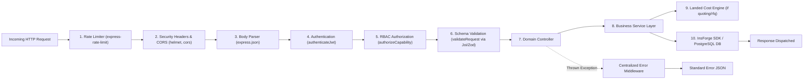

# COVERLY - Backend Architecture & Service Layer Specification

This document details the backend architecture for COVERLY, built on **Node.js**, **Express.js**, and **TypeScript**, integrating directly with the **InsForge PostgreSQL BaaS** (`@insforge/sdk`).

---

## 1. Architectural Patterns & Pipeline



---

## 2. Directory Structure & Domain Modules

```text
backend/src/
├── config/
│   ├── env.ts                 # Validated environment variable schema
│   ├── insforge.ts            # Singleton InsForge SDK client initialization
│   └── cors.ts                # CORS policy & origin whitelists
├── middleware/
│   ├── authenticate.ts        # JWT verification & req.user attachment
│   ├── authorize.ts           # Capability & role gatekeeper
│   ├── validateRequest.ts     # Schema validation middleware
│   ├── errorHandler.ts        # Centralized error handler & status mapper
│   └── rateLimiter.ts         # IP & user-based rate limiters
├── modules/                   # Domain-driven modular structure
│   ├── auth/                  # Register, login, session, password recovery
│   │   ├── auth.controller.ts
│   │   ├── auth.service.ts
│   │   ├── auth.routes.ts
│   │   └── auth.validation.ts
│   ├── businesses/            # Business profiles, onboarding, memberships
│   │   ├── business.controller.ts
│   │   ├── business.service.ts
│   │   └── business.routes.ts
│   ├── verification/          # Document upload, audit queue, badge award
│   │   ├── verification.controller.ts
│   │   ├── verification.service.ts
│   │   └── verification.routes.ts
│   ├── categories/            # Product taxonomy & unit definitions
│   │   ├── category.controller.ts
│   │   ├── category.service.ts
│   │   └── category.routes.ts
│   ├── products/              # Wholesale product catalog & inventory
│   │   ├── product.controller.ts
│   │   ├── product.service.ts
│   │   └── product.routes.ts
│   ├── discovery/             # Supplier search, corridor filters, facets
│   │   ├── discovery.controller.ts
│   │   ├── discovery.service.ts
│   │   └── discovery.routes.ts
│   ├── rfqs/                  # RFQ drafting, submission, matching engine
│   │   ├── rfq.controller.ts
│   │   ├── rfq.service.ts
│   │   ├── matching.service.ts # Algorithmic supplier matching
│   │   └── rfq.routes.ts
│   ├── quotations/            # Quote ingestion, comparison, acceptance
│   │   ├── quotation.controller.ts
│   │   ├── quotation.service.ts
│   │   ├── landedCost.service.ts # Proprietary Landed Cost Engine
│   │   └── quotation.routes.ts
│   ├── orders/                # Purchase Orders, milestone transitions, tracking
│   │   ├── order.controller.ts
│   │   ├── order.service.ts
│   │   └── order.routes.ts
│   ├── notifications/         # Notification dispatch & reading
│   │   ├── notification.controller.ts
│   │   ├── notification.service.ts
│   │   └── notification.routes.ts
│   ├── support/               # Public inquiries, reports, support tickets
│   │   ├── support.controller.ts
│   │   ├── support.service.ts
│   │   └── support.routes.ts
│   └── admin/                 # Superadmin analytics, audit logs, platform config
│       ├── admin.controller.ts
│       ├── admin.service.ts
│       └── admin.routes.ts
├── lib/                       # Shared backend utilities & calculations
│   ├── insforge.ts            # Client singleton
│   └── landed-cost.ts         # Math calculation functions
├── types/                     # Backend TypeScript interfaces
├── routes/
│   └── index.ts               # Master router aggregating all module routes
├── app.ts                     # Express application configuration
└── index.ts                   # Local development server bootstrapper
```

---

## 3. Landed Cost Calculation Engine (`landedCost.service.ts`)

The Landed Cost Engine is COVERLY's core mathematical differentiator. It calculates the true cost of goods delivered at the buyer's destination warehouse:

### Formula Specifications

#### 1. Base Subtotal:
$$\text{Base Subtotal} = \text{Unit Price} \times \text{Quantity}$$

#### 2. Applicable GST Slabs:
In India, wholesale raw materials and manufactured goods fall under statutory GST rates:
$$\text{GST Rate} \in \{0.05, 0.12, 0.18, 0.28\}$$

#### 3. Tax Calculation:
- **For GST-Exclusive Quotes** (Default wholesale trade):
  $$\text{Taxable Subtotal} = \text{Base Subtotal} + (\text{Packaging Charges} \text{ if taxable})$$
  $$\text{GST Amount} = \text{Taxable Subtotal} \times \text{GST Rate}$$
  $$\text{Freight Tax} = \text{Freight} \times \text{GST Rate} \quad (\text{if freight billed by supplier})$$
- **For GST-Inclusive Quotes**:
  $$\text{Base Subtotal} = \frac{\text{Quoted Price} \times \text{Quantity}}{1 + \text{GST Rate}}$$
  $$\text{GST Amount} = (\text{Quoted Price} \times \text{Quantity}) - \text{Base Subtotal}$$

#### 4. True Landed Cost per Unit:
$$\text{Total Landed Cost} = \text{Base Subtotal} + \text{GST Amount} + \text{Freight} + \text{Freight Tax} + \text{Other Charges} - \text{Discounts}$$
$$\text{Landed Cost per Unit} = \frac{\text{Total Landed Cost}}{\text{Quantity}}$$

### Implementation Snippet
```typescript
export function computeLandedCostBreakdown(input: {
  unitPrice: number;
  quantity: number;
  moq: number;
  freight: number;
  freightTaxable: boolean;
  gstRate: number;
  isTaxInclusive: boolean;
  packagingCharges?: number;
  insuranceCharges?: number;
  discounts?: number;
}) {
  const packaging = input.packagingCharges || 0;
  const insurance = input.insuranceCharges || 0;
  const discount = input.discounts || 0;

  let baseSubtotal: number;
  let gstAmount: number;

  if (input.isTaxInclusive) {
    const rawTotal = input.unitPrice * input.quantity;
    baseSubtotal = rawTotal / (1 + input.gstRate);
    gstAmount = rawTotal - baseSubtotal;
  } else {
    baseSubtotal = input.unitPrice * input.quantity;
    gstAmount = (baseSubtotal + packaging) * input.gstRate;
  }

  const freightGst = input.freightTaxable ? input.freight * input.gstRate : 0;
  const totalLandedCost = baseSubtotal + gstAmount + input.freight + freightGst + packaging + insurance - discount;
  const landedPerUnit = totalLandedCost / input.quantity;

  return {
    baseSubtotal: Math.round(baseSubtotal * 100) / 100,
    gstAmount: Math.round(gstAmount * 100) / 100,
    freight: Math.round(input.freight * 100) / 100,
    freightTax: Math.round(freightGst * 100) / 100,
    totalLandedCost: Math.round(totalLandedCost * 100) / 100,
    landedPerUnit: Math.round(landedPerUnit * 100) / 100,
  };
}
```

---

## 4. InsForge SDK Singleton & Multi-Tenant Scoping

App code reads keys securely from environment variables. For user-scoped operations, requests utilize the public `ANON_KEY` accompanied by the caller's JWT:

```typescript
// backend/src/lib/insforge.ts
import { createAdminClient, createClient, type InsForgeClient } from "@insforge/sdk";

let adminClient: InsForgeClient | null = null;

export function getInsForgeClient(): InsForgeClient {
  if (!adminClient) {
    const baseUrl = process.env.INSFORGE_BASE_URL || "https://4vwfw2w8.ap-southeast.insforge.app";
    const apiKey = process.env.INSFORGE_API_KEY;
    const anonKey = process.env.INSFORGE_ANON_KEY;

    if (apiKey) {
      adminClient = createAdminClient({ baseUrl, apiKey });
    } else if (anonKey) {
      adminClient = createClient({ baseUrl, anonKey });
    } else {
      throw new Error("InsForge credentials missing from environment.");
    }
  }
  return adminClient;
}
```

---

## 5. Centralized Error Handler Middleware

All unhandled rejections or controller failures pass through `errorHandler.ts`:

```typescript
export function errorHandler(
  err: any,
  req: Request,
  res: Response,
  next: NextFunction
) {
  const statusCode = err.statusCode || 500;
  const errorCode = err.code || "INTERNAL_SERVER_ERROR";
  const message = err.message || "An unexpected error occurred.";

  if (statusCode === 500) {
    console.error(`[ERROR 500] ${req.method} ${req.url}:`, err);
  }

  res.status(statusCode).json({
    success: false,
    error: {
      code: errorCode,
      message,
      details: err.details || null,
    },
    timestamp: new Date().toISOString(),
  });
}
```
