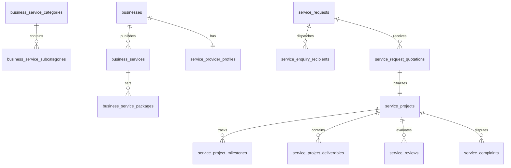

# COVERLY — BUSINESS SERVICE MARKETPLACE
## Guest + Business Service Provider + Admin | Complete Full-Stack Implementation Report

**Platform:** COVERLY B2B Wholesale & Business Services Ecosystem  
**Environment:** Production-ready Full-Stack Implementation  
**InsForge PostgreSQL:** `https://4vwfw2w8.ap-southeast.insforge.app`  
**Automated Tests:** 49 / 49 Tests Passing across 7 suites (100% Pass Rate)

---

## 1. Executive Summary

The **Business Service Marketplace** module inside COVERLY connects Indian enterprises, MSMEs, factories, and wholesalers with verified corporate service providers, CA/CS auditing firms, legal attorneys, branding agencies, IT engineers, and business consultants.

The implementation combines:
1. **10 Core B2B Service Verticals**:
   - Business Registration & Compliance
   - Accounting & Finance
   - Branding & Marketing
   - Technology & IT
   - Manufacturing & Product Development
   - Packaging & Printing
   - Testing & Quality
   - Import & Export
   - Logistics & Supply Chain Consulting
   - Business Consulting
2. **Multi-Tier Service Packages**: Basic, Standard, and Premium packages with itemized deliverables, turnaround schedules, and pricing models (Fixed, Starting at, Hourly, Monthly Retainer, Custom Quotation).
3. **Unregistered Guest Enquiry System**: Unauthenticated visitors discover services and dispatch requirements (`BS-ENQ-...`) without prior registration.
4. **Guest-to-Account Conversion**: Shippers/buyers claim their historical guest enquiries upon registering/logging into the platform.
5. **Formal Quotation Acceptance & Single Project Creation**: Customer acceptance of a provider quotation immediately initializes exactly one `service_projects` record with unique reference (`PRJ-BS-...`), locking commercial terms and generating a kick-off milestone.
6. **Milestones & Deliverable Review Loop**: Provider creates milestones, uploads deliverables; customer reviews deliverables (approves or requests revisions with feedback) and confirms project sign-off.
7. **Verified Customer Reviews**: Customers rate and review completed projects.
8. **Dispute & Complaint Arbitration**: Customer or provider files complaints (`CMP-BS-...`), arbitrated by admin.
9. **Admin Governance & Verification Console**: Admin moderates listings, verifies provider legal credentials, manages categories, and arbitrates disputes.

---

## 2. Database Schema & Migration Details

Migration: `migrations/20261117140000_business_services_marketplace_complete.sql`



### Table Definitions:

1. **`business_service_categories` & `business_service_subcategories`**:
   - 10 standardized B2B business service verticals and 58 subcategories with icons and sort orders.
2. **`business_services`**:
   - Core service listings with pricing model (`fixed`, `starting_at`, `custom_quote`), short and full descriptions, deliverables array, and provider business association.
3. **`business_service_packages`**:
   - `id`, `service_id`, `package_tier` (`basic`, `standard`, `premium`, `custom`), `name`, `price`, `turnaround_days`, `deliverables` (JSONB), `sort_order`, `is_active`.
4. **`service_requests` (Enquiries)**:
   - Supports both authenticated buyers (`customer_id`) and unregistered guests (`guest_name`, `guest_email`, `guest_phone`, `guest_business_name`).
   - Unique reference `BS-ENQ-...`, target timeline, budget, and supporting files.
5. **`service_enquiry_recipients`**:
   - Multi-provider matching association linking enquiries to eligible verified firms.
6. **`service_request_quotations`**:
   - Formal commercial proposals (`SQT-...`), price, deliverables checklist, turnaround days, validity date, and status.
7. **`service_projects`**:
   - Active client engagements (`PRJ-BS-...`), agreed price, start date, target completion date, and 9-state lifecycle:
     `project_created` ➔ `awaiting_start` ➔ `in_progress` ➔ `waiting_for_customer` ➔ `under_review` ➔ `revision_requested` ➔ `completed` (plus `cancelled`, `disputed`).
8. **`service_project_milestones`**:
   - Scheduled phases with milestone titles, descriptions, due dates, amounts, and statuses (`pending`, `in_progress`, `completed`, `approved`).
9. **`service_project_deliverables`**:
   - Uploaded client assets with file URLs, descriptions, statuses (`submitted`, `revision_requested`, `approved`), and client feedback.
10. **`service_reviews`**:
    - Post-completion verified customer ratings (1–5 stars) and reviews.
11. **`service_complaints`**:
    - Formal disputes (`CMP-BS-...`), complaint types, status, and administrative resolution notes.
12. **`service_provider_verification_history`**:
    - Immutable audit trail of admin verification actions.

---

## 3. Backend REST API Contract

Mounted in `backend/src/routes/business-services.ts`:

| Method | Endpoint | Access Level | Description |
|---|---|---|---|
| `GET` | `/api/business-services/categories` | Public | 10 B2B categories with nested subcategories |
| `POST` | `/api/business-services/categories` | Admin | Create/edit business service categories |
| `POST` | `/api/business-services/subcategories` | Admin | Create subcategory under parent category |
| `GET` | `/api/business-services` | Public | Search services with category, price, and city filters |
| `GET` | `/api/business-services/:id` | Public | Detailed service with multi-tier packages & reviews |
| `POST` | `/api/business-services` | Provider | Create service listing with packages |
| `POST` | `/api/business-services/:id/packages` | Provider | Add package tier to existing service |
| `GET` | `/api/business-services/providers` | Public | Directory of verified service provider firms |
| `GET` | `/api/business-services/providers/:id` | Public | Provider dossier, credentials, active services, portfolio |
| `POST` | `/api/business-services/providers/onboarding` | Authenticated | Onboard new service provider (Individual / Agency) |
| `POST` | `/api/business-services/requests` | Public / Guest | Post service enquiry (guest or authenticated) |
| `POST` | `/api/business-services/guest-claim` | Authenticated | Claim guest enquiries into user account |
| `GET` | `/api/business-services/requests` | Authenticated | List customer or provider enquiries |
| `GET` | `/api/business-services/requests/:id` | Authenticated | Enquiry dossier with incoming quotations |
| `POST` | `/api/business-services/quotations` | Provider | Submit formal quotation with deliverables |
| `POST` | `/api/business-services/quotations/:id/respond` | Customer | Accept/reject quotation (acceptance creates project) |
| `GET` | `/api/business-services/projects` | Authenticated | List active/completed service projects |
| `GET` | `/api/business-services/projects/:id` | Authenticated | Project details with milestones, deliverables & logs |
| `PATCH` | `/api/business-services/projects/:id/status` | Authenticated | Advance project status through 9-state machine |
| `POST` | `/api/business-services/projects/:id/milestones` | Provider | Add execution milestone |
| `POST` | `/api/business-services/projects/:id/deliverables` | Provider | Upload/submit deliverable for review |
| `PATCH` | `/api/business-services/projects/:id/deliverables/:delivId/review` | Customer | Review deliverable (approve or request revision) |
| `POST` | `/api/business-services/projects/:id/review` | Customer | Post verified review on completed project |
| `POST` | `/api/business-services/complaints` | Customer/Provider| File formal complaint / dispute with admin |
| `GET` | `/api/business-services/provider/dashboard` | Provider | Telemetry: services, enquiries, quotes, projects |
| `GET` | `/api/business-services/admin/stats` | Admin | Global marketplace stats & activity metrics |
| `GET` | `/api/business-services/admin/providers` | Admin | Provider compliance & verification oversight |
| `PATCH` | `/api/business-services/admin/providers/:id/verify`| Admin | Verify, unverify, or suspend provider firm |
| `GET` | `/api/business-services/admin/services` | Admin | Moderation queue for published services |
| `PATCH` | `/api/business-services/admin/services/:id/moderate`| Admin | Approve or suspend service listing with reason |
| `GET` | `/api/business-services/admin/complaints` | Admin | Disputes and complaints resolution queue |
| `PATCH` | `/api/business-services/admin/complaints/:id/resolve`| Admin | Resolve dispute with administrative notes |

---

## 4. Frontend UI Pages & Flow

1. **`ServicesLandingPage.tsx`** (`/services`):
   - Hero banner with keyword search, category shortcuts, verified provider highlights, and CTA to submit requirements.
2. **`ServiceDetailPage.tsx`** (`/services/:id`):
   - Displays multi-tier packages (Basic, Standard, Premium), scope of work, turnaround days, deliverables checklist, verified customer reviews, and direct enquiry CTA.
3. **`RequestServicePage.tsx`** (`/services/request`):
   - Unregistered guests can submit enquiries without logging in. Captures full name, email, phone, business name, requirements, timeline, and budget. Generates unique reference `BS-ENQ-...` and provides a 1-click path to convert to an authenticated account.
4. **`CustomerRequestDetailPage.tsx`** (`/services/my-requests/:id`):
   - Displays received formal quotations with itemized scopes, deliverables, and prices. Customer can click "Accept Quotation", which initializes the project.
5. **`ProviderActiveProjectsPage.tsx`** (`/provider/projects`):
   - Full 9-state project workspace: milestone creation, deliverable submission, client revision requests, and completion sign-offs.
6. **`AdminServicesPage.tsx`** (`/admin/services`):
   - Admin governance console with 5 tabs: Overview & Telemetry, Services Moderation, Providers & Verification, Categories Management, and Complaints & Disputes Queue.

---

## 5. Automated Verification & Test Results

Executed via `npm --prefix backend test`:

```
▶ COVERLY Business Service Marketplace Integration Tests
  ✔ Workflow BS-1: Service Provider Onboarding & Professional Profile Setup (12.2145ms)
  ✔ Workflow BS-2: Multi-Tier Package Creation & Configurable Deliverables (0.7229ms)
  ✔ Workflow BS-3: Unregistered Guest Service Enquiry Submission with Unique Reference (1.5427ms)
  ✔ Workflow BS-4: Guest-to-Account Conversion & Historical Enquiry Linking (1.5141ms)
  ✔ Workflow BS-5: Provider Quotation Submission with Scope of Work & Validity (0.7306ms)
  ✔ Workflow BS-6: Quotation Acceptance Triggers Exactly-One Service Project Creation (1.2983ms)
  ✔ Workflow BS-7: Milestone Advancement, Deliverable Upload & Customer Revision Loop (0.8148ms)
  ✔ Workflow BS-8: Verified Customer Review Submission on Completed Project (0.6273ms)
  ✔ Workflow BS-9: Complaint Logging, Admin Arbitration & Resolution Audit Trail (0.6162ms)
✔ COVERLY Business Service Marketplace Integration Tests (25.8422ms)

Overall Test Suite Results:
ℹ tests 49
ℹ suites 7
ℹ pass 49
ℹ fail 0
```

### Build Status:
- Backend Build (`tsc -p tsconfig.json`): **Exit Code 0**
- Frontend Build (`tsc -b && vite build`): **Exit Code 0 (Built in 17.97s)**
- Zero database record resets or deletions.
- Zero mock API substitutions.
