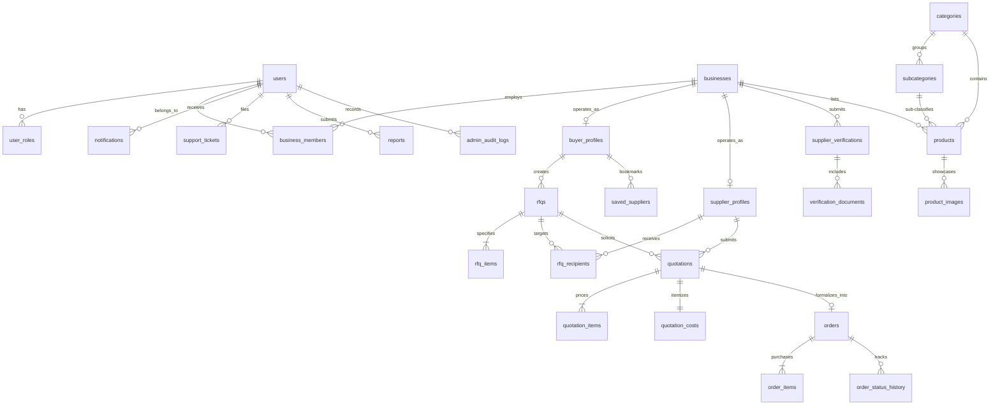

# COVERLY - PostgreSQL Database Architecture & Schema Specification

This document provides the definitive data architecture for COVERLY, deployed on the linked [InsForge PostgreSQL](https://insforge.dev) backend (`4vwfw2w8.ap-southeast.insforge.app`).

---

## 1. Entity-Relationship Overview



---

## 2. Complete Entity Catalog (26 Tables)

### Section A: Identity & Organization

#### 1. `public.users`
*Represents individual human users registered via InsForge Auth.*
- `id` (UUID, PK, References `auth.users(id)` ON DELETE CASCADE)
- `email` (TEXT, UNIQUE, NOT NULL)
- `phone` (TEXT, UNIQUE, NULL)
- `full_name` (TEXT, NOT NULL)
- `avatar_url` (TEXT, NULL)
- `is_active` (BOOLEAN, DEFAULT true)
- `created_at` (TIMESTAMPTZ, DEFAULT now())
- `updated_at` (TIMESTAMPTZ, DEFAULT now())

#### 2. `public.user_roles`
*Maintains active roles per user; supports multi-role users (`buyer_supplier`, `admin`).*
- `id` (UUID, PK, DEFAULT gen_random_uuid())
- `user_id` (UUID, References `public.users(id)` ON DELETE CASCADE)
- `role` (TEXT, NOT NULL, CHECK in `'guest'`, `'buyer'`, `'manufacturer'`, `'wholesaler'`, `'distributor'`, `'buyer_supplier'`, `'admin'`, `'verification_admin'`, `'support_admin'`)
- `created_at` (TIMESTAMPTZ, DEFAULT now())
- *Constraint*: `UNIQUE(user_id, role)`

#### 3. `public.businesses`
*The legal commercial entity (Company, Firm, Proprietorship) owning operations.*
- `id` (UUID, PK, DEFAULT gen_random_uuid())
- `legal_name` (TEXT, NOT NULL)
- `trade_name` (TEXT, NOT NULL)
- `entity_type` (TEXT, CHECK in `'proprietorship'`, `'partnership'`, `'llp'`, `'pvt_ltd'`, `'public_ltd'`)
- `gstin` (TEXT, UNIQUE, NULL)
- `pan` (TEXT, NULL)
- `registered_address` (TEXT, NOT NULL)
- `city` (TEXT, NOT NULL)
- `state` (TEXT, NOT NULL)
- `pincode` (VARCHAR(6), NOT NULL)
- `verification_level` (TEXT, DEFAULT `'level_0'`, CHECK in `'level_0'`, `'level_1'`, `'level_2'`, `'level_3'`, `'level_4'`)
- `is_active` (BOOLEAN, DEFAULT true)
- `created_at` (TIMESTAMPTZ, DEFAULT now())
- `updated_at` (TIMESTAMPTZ, DEFAULT now())

#### 4. `public.business_members`
*Binds users to businesses with role-based access inside that organization.*
- `id` (UUID, PK, DEFAULT gen_random_uuid())
- `business_id` (UUID, References `public.businesses(id)` ON DELETE CASCADE)
- `user_id` (UUID, References `public.users(id)` ON DELETE CASCADE)
- `member_role` (TEXT, DEFAULT `'owner'`, CHECK in `'owner'`, `'manager'`, `'staff'`)
- `created_at` (TIMESTAMPTZ, DEFAULT now())
- *Constraint*: `UNIQUE(business_id, user_id)`

#### 5. `public.buyer_profiles`
*Operational buyer metadata, default shipping lanes, and preferences.*
- `id` (UUID, PK, DEFAULT gen_random_uuid())
- `business_id` (UUID, UNIQUE, References `public.businesses(id)` ON DELETE CASCADE)
- `default_delivery_city` (TEXT, NOT NULL DEFAULT 'Raipur')
- `default_delivery_pincode` (VARCHAR(6), NOT NULL DEFAULT '492001')
- `annual_procurement_bracket` (TEXT, NULL)
- `created_at` (TIMESTAMPTZ, DEFAULT now())
- `updated_at` (TIMESTAMPTZ, DEFAULT now())

#### 6. `public.supplier_profiles`
*Commercial supplier capabilities, operational categorization, and plant metadata.*
- `id` (UUID, PK, DEFAULT gen_random_uuid())
- `business_id` (UUID, UNIQUE, References `public.businesses(id)` ON DELETE CASCADE)
- `supplier_type` (TEXT, NOT NULL, CHECK in `'manufacturer'`, `'wholesaler'`, `'distributor'`)
- `primary_category_id` (TEXT, NOT NULL)
- `factory_address` (TEXT, NULL)
- `plant_size_sqft` (INTEGER, NULL)
- `monthly_capacity_units` (INTEGER, NULL)
- `installed_machinery` (TEXT[], NULL)
- `operating_shifts` (INTEGER, DEFAULT 1)
- `average_dispatch_days` (INTEGER, DEFAULT 3)
- `created_at` (TIMESTAMPTZ, DEFAULT now())
- `updated_at` (TIMESTAMPTZ, DEFAULT now())

---

### Section B: Ground-Truth Verification

#### 7. `public.supplier_verifications`
*Tracks formal verification review cycles submitted by suppliers.*
- `id` (UUID, PK, DEFAULT gen_random_uuid())
- `business_id` (UUID, References `public.businesses(id)` ON DELETE CASCADE)
- `requested_level` (TEXT, NOT NULL, CHECK in `'level_3'`, `'level_4'`)
- `status` (TEXT, DEFAULT `'pending'`, CHECK in `'pending'`, `'action_required'`, `'approved'`, `'rejected'`)
- `reviewed_by` (UUID, References `public.users(id)`, NULL)
- `admin_remarks` (TEXT, NULL)
- `audited_at` (TIMESTAMPTZ, NULL)
- `created_at` (TIMESTAMPTZ, DEFAULT now())
- `updated_at` (TIMESTAMPTZ, DEFAULT now())

#### 8. `public.verification_documents`
*Secure storage references for uploaded certificates and plant photos.*
- `id` (UUID, PK, DEFAULT gen_random_uuid())
- `verification_id` (UUID, References `public.supplier_verifications(id)` ON DELETE CASCADE)
- `document_type` (TEXT, NOT NULL, CHECK in `'gstin_cert'`, `'udyam_cert'`, `'business_pan'`, `'electricity_bill'`, `'plant_photo'`, `'iso_cert'`)
- `storage_bucket` (TEXT, NOT NULL DEFAULT 'verification-docs')
- `storage_key` (TEXT, NOT NULL)
- `public_url` (TEXT, NOT NULL)
- `file_size_bytes` (INTEGER, NOT NULL)
- `mime_type` (TEXT, NOT NULL)
- `status` (TEXT, DEFAULT `'pending'`, CHECK in `'pending'`, `'verified'`, `'rejected'`)
- `created_at` (TIMESTAMPTZ, DEFAULT now())

---

### Section C: Taxonomy & Products

#### 9. `public.categories`
*Primary industrial taxonomy (Textiles, Packaging, Steel, Chemicals).*
- `id` (TEXT, PK) -- e.g., 'cotton-tshirts', 'mild-steel-rods'
- `label` (TEXT, NOT NULL)
- `unit` (TEXT, NOT NULL DEFAULT 'pc')
- `default_qty` (INTEGER, NOT NULL DEFAULT 500)
- `icon_name` (TEXT, NULL)
- `is_active` (BOOLEAN, DEFAULT true)
- `created_at` (TIMESTAMPTZ, DEFAULT now())

#### 10. `public.subcategories`
*Granular classifications within categories.*
- `id` (TEXT, PK) -- e.g., 'round-neck-tees', 'polo-tees'
- `category_id` (TEXT, References `public.categories(id)` ON DELETE CASCADE)
- `label` (TEXT, NOT NULL)
- `created_at` (TIMESTAMPTZ, DEFAULT now())

#### 11. `public.products`
*Wholesale merchandise and bulk listing catalog.*
- `id` (UUID, PK, DEFAULT gen_random_uuid())
- `business_id` (UUID, References `public.businesses(id)` ON DELETE CASCADE)
- `category_id` (TEXT, References `public.categories(id)`)
- `subcategory_id` (TEXT, References `public.subcategories(id)`, NULL)
- `title` (TEXT, NOT NULL)
- `description` (TEXT, NOT NULL)
- `hsn_code` (VARCHAR(10), NOT NULL)
- `gst_rate` (NUMERIC(5, 4), NOT NULL) -- 0.05, 0.12, 0.18, 0.28
- `base_unit_price` (NUMERIC(12, 2), NOT NULL)
- `moq` (INTEGER, NOT NULL DEFAULT 100)
- `unit` (TEXT, NOT NULL DEFAULT 'pc')
- `is_tax_inclusive` (BOOLEAN, DEFAULT false)
- `is_active` (BOOLEAN, DEFAULT true)
- `created_at` (TIMESTAMPTZ, DEFAULT now())
- `updated_at` (TIMESTAMPTZ, DEFAULT now())

#### 12. `public.product_images`
*Product media gallery entries.*
- `id` (UUID, PK, DEFAULT gen_random_uuid())
- `product_id` (UUID, References `public.products(id)` ON DELETE CASCADE)
- `storage_bucket` (TEXT, NOT NULL DEFAULT 'product-images')
- `storage_key` (TEXT, NOT NULL)
- `public_url` (TEXT, NOT NULL)
- `display_order` (INTEGER, DEFAULT 0)
- `is_primary` (BOOLEAN, DEFAULT false)
- `created_at` (TIMESTAMPTZ, DEFAULT now())

---

### Section D: Requests for Quotation (RFQs)

#### 13. `public.rfqs`
*Core procurement requirement issued by a buyer.*
- `id` (UUID, PK, DEFAULT gen_random_uuid())
- `buyer_id` (UUID, References `public.buyer_profiles(id)` ON DELETE CASCADE)
- `rfq_code` (TEXT, UNIQUE, NOT NULL) -- e.g., 'RFQ-2026-8492'
- `category_id` (TEXT, References `public.categories(id)`)
- `title` (TEXT, NOT NULL)
- `status` (TEXT, DEFAULT `'draft'`, CHECK in `'draft'`, `'submitted'`, `'matching'`, `'sent'`, `'responses_received'`, `'closed'`, `'cancelled'`)
- `destination_city` (TEXT, NOT NULL)
- `destination_pincode` (VARCHAR(6), NOT NULL)
- `target_delivery_date` (DATE, NOT NULL)
- `unloading_available` (BOOLEAN, DEFAULT true)
- `matching_mode` (TEXT, DEFAULT `'coverly_match'`, CHECK in `'coverly_match'`, `'handpicked'`)
- `created_at` (TIMESTAMPTZ, DEFAULT now())
- `updated_at` (TIMESTAMPTZ, DEFAULT now())

#### 14. `public.rfq_items`
*Granular item lines specified in an RFQ.*
- `id` (UUID, PK, DEFAULT gen_random_uuid())
- `rfq_id` (UUID, References `public.rfqs(id)` ON DELETE CASCADE)
- `item_name` (TEXT, NOT NULL)
- `technical_specs` (JSONB, NOT NULL DEFAULT '{}'::jsonb) -- { gsm, grade, color, dimensions }
- `quantity` (INTEGER, NOT NULL)
- `unit` (TEXT, NOT NULL)
- `target_unit_price` (NUMERIC(12, 2), NULL)
- `created_at` (TIMESTAMPTZ, DEFAULT now())

#### 15. `public.rfq_recipients`
*Tracks which suppliers were targeted or matched with an RFQ.*
- `id` (UUID, PK, DEFAULT gen_random_uuid())
- `rfq_id` (UUID, References `public.rfqs(id)` ON DELETE CASCADE)
- `supplier_id` (UUID, References `public.supplier_profiles(id)` ON DELETE CASCADE)
- `status` (TEXT, DEFAULT `'dispatched'`, CHECK in `'dispatched'`, `'viewed'`, `'quoted'`, `'declined'`)
- `decline_reason` (TEXT, NULL)
- `viewed_at` (TIMESTAMPTZ, NULL)
- `created_at` (TIMESTAMPTZ, DEFAULT now())
- *Constraint*: `UNIQUE(rfq_id, supplier_id)`

---

### Section E: Quotations & Landed Costs

#### 16. `public.quotations`
*A binding formal quote submitted by a supplier.*
- `id` (UUID, PK, DEFAULT gen_random_uuid())
- `quote_code` (TEXT, UNIQUE, NOT NULL) -- e.g., 'Q-2026-4102'
- `rfq_id` (UUID, References `public.rfqs(id)` ON DELETE CASCADE)
- `supplier_id` (UUID, References `public.supplier_profiles(id)` ON DELETE CASCADE)
- `status` (TEXT, DEFAULT `'submitted'`, CHECK in `'draft'`, `'submitted'`, `'under_review'`, `'accepted'`, `'rejected'`, `'expired'`, `'withdrawn'`)
- `production_lead_time_days` (INTEGER, NOT NULL DEFAULT 5)
- `payment_terms` (TEXT, NOT NULL DEFAULT '30-70') -- '100% Advance', '30% Advance 70% on Dispatch', 'Net 30'
- `valid_until` (TIMESTAMPTZ, NOT NULL)
- `special_notes` (TEXT, NULL)
- `created_at` (TIMESTAMPTZ, DEFAULT now())
- `updated_at` (TIMESTAMPTZ, DEFAULT now())

#### 17. `public.quotation_items`
*Line item rates provided by the quoting supplier.*
- `id` (UUID, PK, DEFAULT gen_random_uuid())
- `quotation_id` (UUID, References `public.quotations(id)` ON DELETE CASCADE)
- `rfq_item_id` (UUID, References `public.rfq_items(id)`)
- `unit_price` (NUMERIC(12, 2), NOT NULL)
- `quoted_quantity` (INTEGER, NOT NULL)
- `moq` (INTEGER, NOT NULL)
- `created_at` (TIMESTAMPTZ, DEFAULT now())

#### 18. `public.quotation_costs`
*Normalized mathematical cost center breakdown for true landed evaluation.*
- `id` (UUID, PK, DEFAULT gen_random_uuid())
- `quotation_id` (UUID, UNIQUE, References `public.quotations(id)` ON DELETE CASCADE)
- `base_subtotal` (NUMERIC(12, 2), NOT NULL)
- `freight` (NUMERIC(12, 2), NOT NULL DEFAULT 0.00)
- `freight_taxable` (BOOLEAN, DEFAULT false)
- `gst_rate` (NUMERIC(5, 4), NOT NULL)
- `gst_amount` (NUMERIC(12, 2), NOT NULL)
- `packaging_charges` (NUMERIC(12, 2), DEFAULT 0.00)
- `insurance_charges` (NUMERIC(12, 2), DEFAULT 0.00)
- `discounts` (NUMERIC(12, 2), DEFAULT 0.00)
- `total_landed_cost` (NUMERIC(12, 2), NOT NULL)
- `landed_cost_per_unit` (NUMERIC(12, 2), NOT NULL)
- `calculation_version` (TEXT, DEFAULT 'v1.0')
- `created_at` (TIMESTAMPTZ, DEFAULT now())

---

### Section F: Orders & Fulfillment

#### 19. `public.orders`
*Binding Purchase Order created upon quotation acceptance.*
- `id` (UUID, PK, DEFAULT gen_random_uuid())
- `po_code` (TEXT, UNIQUE, NOT NULL) -- e.g., 'PO-2026-8492'
- `buyer_id` (UUID, References `public.buyer_profiles(id)`)
- `supplier_id` (UUID, References `public.supplier_profiles(id)`)
- `quotation_id` (UUID, UNIQUE, References `public.quotations(id)`)
- `rfq_id` (UUID, References `public.rfqs(id)`)
- `status` (TEXT, DEFAULT `'pending_confirmation'`, CHECK in `'pending_confirmation'`, `'confirmed'`, `'processing'`, `'ready_for_dispatch'`, `'dispatched'`, `'delivered'`, `'completed'`, `'cancelled'`)
- `total_landed_amount` (NUMERIC(12, 2), NOT NULL)
- `advance_amount_due` (NUMERIC(12, 2), NOT NULL DEFAULT 0.00)
- `balance_amount_due` (NUMERIC(12, 2), NOT NULL)
- `shipping_address` (TEXT, NOT NULL)
- `carrier_name` (TEXT, NULL)
- `eway_bill_number` (VARCHAR(15), NULL)
- `vehicle_number` (VARCHAR(15), NULL)
- `tracking_url` (TEXT, NULL)
- `created_at` (TIMESTAMPTZ, DEFAULT now())
- `updated_at` (TIMESTAMPTZ, DEFAULT now())

#### 20. `public.order_items`
*Order line items derived from accepted quotation.*
- `id` (UUID, PK, DEFAULT gen_random_uuid())
- `order_id` (UUID, References `public.orders(id)` ON DELETE CASCADE)
- `item_name` (TEXT, NOT NULL)
- `quantity` (INTEGER, NOT NULL)
- `unit_price` (NUMERIC(12, 2), NOT NULL)
- `gst_rate` (NUMERIC(5, 4), NOT NULL)
- `subtotal` (NUMERIC(12, 2), NOT NULL)
- `created_at` (TIMESTAMPTZ, DEFAULT now())

#### 21. `public.order_status_history`
*Immutable historical log of all fulfillment milestone transitions.*
- `id` (UUID, PK, DEFAULT gen_random_uuid())
- `order_id` (UUID, References `public.orders(id)` ON DELETE CASCADE)
- `previous_status` (TEXT, NULL)
- `new_status` (TEXT, NOT NULL)
- `changed_by_user_id` (UUID, References `public.users(id)`)
- `reason` (TEXT, NULL)
- `created_at` (TIMESTAMPTZ, DEFAULT now())

---

### Section G: Operations, Support & Audit

#### 22. `public.saved_suppliers`
*Buyer bookmarked supplier list.*
- `id` (UUID, PK, DEFAULT gen_random_uuid())
- `buyer_id` (UUID, References `public.buyer_profiles(id)` ON DELETE CASCADE)
- `supplier_id` (UUID, References `public.supplier_profiles(id)` ON DELETE CASCADE)
- `internal_note` (TEXT, NULL)
- `created_at` (TIMESTAMPTZ, DEFAULT now())
- *Constraint*: `UNIQUE(buyer_id, supplier_id)`

#### 23. `public.notifications`
*In-app notification queue.*
- `id` (UUID, PK, DEFAULT gen_random_uuid())
- `user_id` (UUID, References `public.users(id)` ON DELETE CASCADE)
- `title` (TEXT, NOT NULL)
- `message` (TEXT, NOT NULL)
- `notification_type` (TEXT, NOT NULL) -- 'rfq_received', 'quote_submitted', 'order_status_update', 'verification_alert'
- `action_url` (TEXT, NULL)
- `is_read` (BOOLEAN, DEFAULT false)
- `created_at` (TIMESTAMPTZ, DEFAULT now())

#### 24. `public.reports`
*Dispute, violation, and counterfeit reports.*
- `id` (UUID, PK, DEFAULT gen_random_uuid())
- `reporter_user_id` (UUID, References `public.users(id)`)
- `reported_business_id` (UUID, References `public.businesses(id)`, NULL)
- `reported_product_id` (UUID, References `public.products(id)`, NULL)
- `order_id` (UUID, References `public.orders(id)`, NULL)
- `issue_type` (TEXT, NOT NULL) -- 'fraud', 'counterfeit', 'delivery_failure', 'unresponsive'
- `description` (TEXT, NOT NULL)
- `status` (TEXT, DEFAULT `'open'`, CHECK in `'open'`, `'under_investigation'`, `'resolved'`, `'dismissed'`)
- `resolution_notes` (TEXT, NULL)
- `created_at` (TIMESTAMPTZ, DEFAULT now())

#### 25. `public.support_tickets`
*Customer support ticketing ledger.*
- `id` (UUID, PK, DEFAULT gen_random_uuid())
- `user_id` (UUID, References `public.users(id)`, NULL)
- `requester_email` (TEXT, NOT NULL)
- `subject` (TEXT, NOT NULL)
- `message` (TEXT, NOT NULL)
- `status` (TEXT, DEFAULT `'open'`, CHECK in `'open'`, `'in_progress'`, `'resolved'`, `'closed'`)
- `assigned_to` (UUID, References `public.users(id)`, NULL)
- `created_at` (TIMESTAMPTZ, DEFAULT now())
- `updated_at` (TIMESTAMPTZ, DEFAULT now())

#### 26. `public.admin_audit_logs`
*Immutable system-wide compliance log.*
- `id` (UUID, PK, DEFAULT gen_random_uuid())
- `admin_user_id` (UUID, References `public.users(id)`)
- `action_type` (TEXT, NOT NULL) -- 'user_suspended', 'verification_approved', 'product_delisted', 'setting_modified'
- `target_entity_type` (TEXT, NOT NULL)
- `target_entity_id` (TEXT, NOT NULL)
- `ip_address` (TEXT, NULL)
- `metadata` (JSONB, NOT NULL DEFAULT '{}'::jsonb)
- `created_at` (TIMESTAMPTZ, DEFAULT now())

---

## 3. High-Performance Indexing Strategy

```sql
-- Supplier discovery & geo-filtering
CREATE INDEX idx_businesses_city_state ON public.businesses(city, state);
CREATE INDEX idx_businesses_verification ON public.businesses(verification_level);
CREATE INDEX idx_products_category ON public.products(category_id, is_active);
CREATE INDEX idx_products_moq_price ON public.products(moq, base_unit_price);

-- RFQ & Quotation querying
CREATE INDEX idx_rfqs_buyer ON public.rfqs(buyer_id, status);
CREATE INDEX idx_rfq_recipients_supplier ON public.rfq_recipients(supplier_id, status);
CREATE INDEX idx_quotations_rfq ON public.quotations(rfq_id, status);
CREATE INDEX idx_quotation_costs_landed ON public.quotation_costs(landed_cost_per_unit);

-- Order milestone tracking
CREATE INDEX idx_orders_buyer ON public.orders(buyer_id, status);
CREATE INDEX idx_orders_supplier ON public.orders(supplier_id, status);
CREATE INDEX idx_order_status_history_order ON public.order_status_history(order_id, created_at DESC);
```

---

## 4. InsForge Storage Bucket Configuration

1. **`verification-docs`** (Private Bucket):
   - Stores GSTIN certificates, Udyam MSME slips, electricity bills, and plant inspection media.
   - Gated by InsForge RLS: Readable *only* by uploading business members and authorized `admin` / `verification_admin` roles.
2. **`product-images`** (Public Bucket):
   - Stores public wholesale catalog photography.
   - Public read enabled; write restricted to authenticated product owners.
