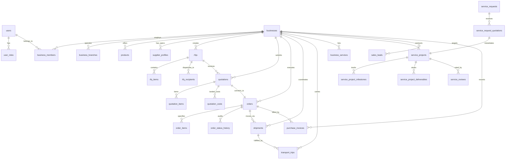

# COVERLY – DATABASE RELATIONSHIP DESIGN & SCHEMA SPECIFICATION
## Phase 1: Entity-Relationship Models, Foreign Keys & Storage Mappings

---

## 1. Core Domain Relationships (ERD)

---

## 2. Table Schemas, Constraints & Foreign Key Registry

### 2.1 Identity & Multi-Tenancy
- **`users`**:
  - `id` (uuid, PK, default `gen_random_uuid()`)
  - `email` (text, UNIQUE, NOT NULL)
  - `full_name` (text, NOT NULL)
  - `phone` (text)
  - `created_at` (timestamptz)
- **`businesses`**:
  - `id` (uuid, PK, default `gen_random_uuid()`)
  - `name` (text, NOT NULL)
  - `legal_name` (text)
  - `slug` (text, UNIQUE, NOT NULL)
  - `business_type` (text, NOT NULL)
  - `city` (text), `state` (text), `pincode` (text)
  - `verification_level` (text, default 'unverified')
  - `is_active` (boolean, default true)
- **`business_members`**:
  - `id` (uuid, PK)
  - `business_id` (uuid, FK -> `businesses.id`, ON DELETE CASCADE)
  - `user_id` (uuid, FK -> `users.id`, ON DELETE CASCADE)
  - `role` (text, NOT NULL)
  - `spending_limit` (numeric, default 0)
  - `is_active` (boolean, default true)
  - `created_at` (timestamptz)
- **`business_branches`**:
  - `id` (uuid, PK)
  - `business_id` (uuid, FK -> `businesses.id`, ON DELETE CASCADE)
  - `branch_name` (text, NOT NULL)
  - `branch_type` (text)
  - `city` (text), `state` (text), `address` (text)

### 2.2 Marketplace & Sourcing
- **`products`**:
  - `id` (uuid, PK)
  - `business_id` (uuid, FK -> `businesses.id`, ON DELETE CASCADE)
  - `category_id` (uuid, FK -> `categories.id`)
  - `title` (text, NOT NULL), `slug` (text)
  - `moq` (numeric, default 1), `unit` (text)
  - `indicative_price` (numeric)
  - `specifications` (jsonb), `is_active` (boolean)
- **`rfqs`**:
  - `id` (uuid, PK)
  - `buyer_id` (uuid, FK -> `users.id`)
  - `business_id` (uuid, FK -> `businesses.id`)
  - `title` (text, NOT NULL)
  - `status` (text, default 'published')
  - `created_at` (timestamptz)
- **`rfq_items`**:
  - `id` (uuid, PK)
  - `rfq_id` (uuid, FK -> `rfqs.id`, ON DELETE CASCADE)
  - `product_name` (text, NOT NULL), `quantity` (numeric), `unit` (text), `target_price` (numeric)

### 2.3 Quotations & Orders
- **`quotations`**:
  - `id` (uuid, PK)
  - `rfq_id` (uuid, FK -> `rfqs.id`, ON DELETE SET NULL)
  - `supplier_business_id` (uuid, FK -> `businesses.id`, ON DELETE CASCADE)
  - `subtotal` (numeric), `gst_amount` (numeric), `freight_charge` (numeric), `grand_total` (numeric)
  - `status` (text, default 'submitted')
- **`orders`**:
  - `id` (uuid, PK)
  - `po_number` (text, UNIQUE, NOT NULL)
  - `buyer_business_id` (uuid, FK -> `businesses.id`)
  - `supplier_business_id` (uuid, FK -> `businesses.id`)
  - `quotation_id` (uuid, FK -> `quotations.id`)
  - `total_amount` (numeric), `status` (text, default 'pending_deposit')

### 2.4 Logistics & Transportation
- **`shipments`**:
  - `id` (uuid, PK)
  - `order_id` (uuid, FK -> `orders.id`, ON DELETE SET NULL)
  - `logistics_partner_id` (uuid, FK -> `businesses.id`)
  - `tracking_number` (text, UNIQUE)
  - `status` (text, default 'booked')
- **`transport_trips`**:
  - `id` (uuid, PK)
  - `transporter_business_id` (uuid, FK -> `businesses.id`)
  - `vehicle_number` (text), `driver_name` (text), `driver_phone` (text)
  - `e_way_bill` (text), `status` (text, default 'assigned')

### 2.5 Business Services
- **`service_projects`**:
  - `id` (uuid, PK)
  - `client_business_id` (uuid, FK -> `businesses.id`)
  - `provider_business_id` (uuid, FK -> `businesses.id`)
  - `title` (text, NOT NULL), `status` (text, default 'in_progress')
- **`service_project_milestones`**:
  - `id` (uuid, PK)
  - `project_id` (uuid, FK -> `service_projects.id`, ON DELETE CASCADE)
  - `sequence` (integer), `title` (text), `amount` (numeric), `status` (text)

---

## 3. Row-Level Security (RLS) Policy Specifications

1. **`businesses`**:
   - `SELECT`: Public access for active profiles (`is_active = true`). Private columns restricted to members.
   - `INSERT`: Authenticated users can register a business.
   - `UPDATE`: Allowed only for `business_members` with role in `['owner', 'business_manager']`.
2. **`rfqs` & `quotations`**:
   - `SELECT`: Owner buyer, dispatchees, and admin.
   - `UPDATE`: Disallowed once order is issued or quotation accepted.
3. **`orders` & `invoices`**:
   - `SELECT`: Restricted to buyer business members and supplier business members.
   - `UPDATE`: State transitions strictly enforced via server-side state machine.
