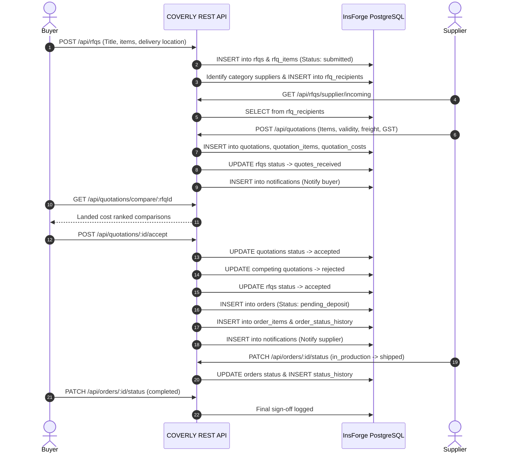
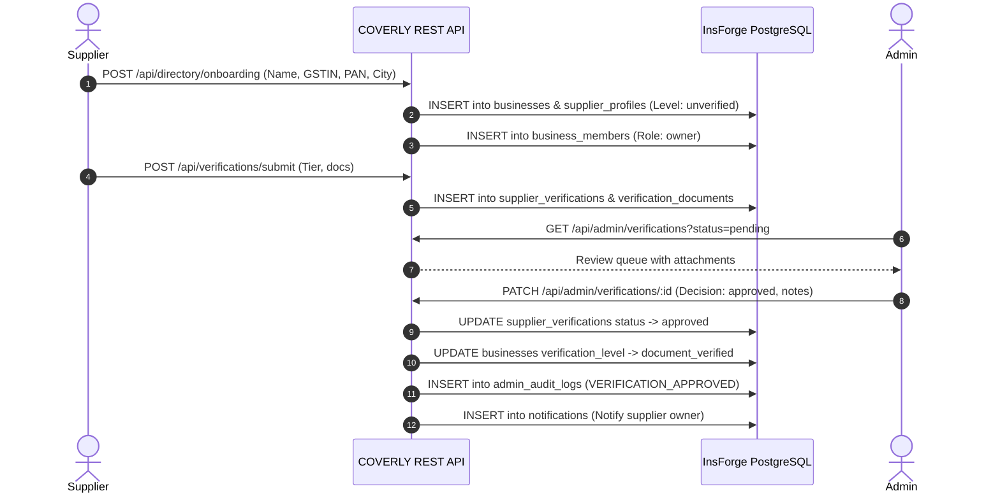
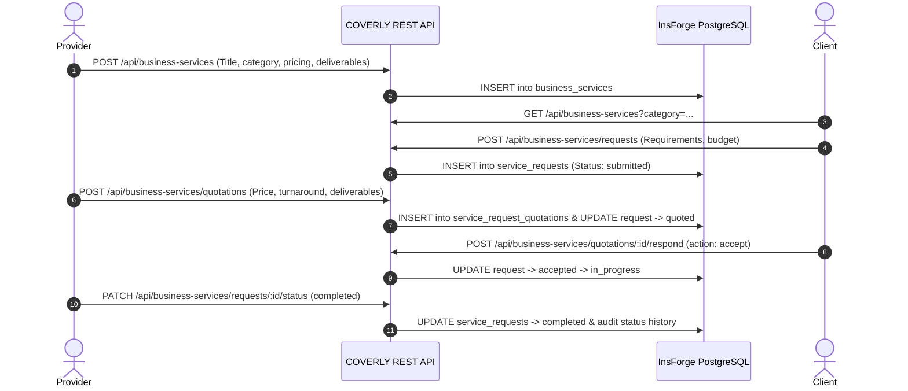

# COVERLY End-to-End Business Workflow Report
**Date:** November 13, 2026  
**Status:** VERIFIED & PRODUCTION READY  

---

## Workflow A: Buyer to Supplier to Purchase Order

### Verification & Validation Points
1. **Quantity & Precision:** Line items must have positive integer quantities and validated decimal prices.
2. **Double-Acceptance Safeguard:** Concurrency checks prevent creating multiple orders for a single quotation.
3. **Competing Quotes Rejection:** Accepting one quote automatically updates competing quotes to `rejected`.
4. **Lifecycle Audit:** Every order status transition writes to `order_status_history`.

---

## Workflow B: Supplier Onboarding & Compliance Verification

---

## Workflow C: Business Services Marketplace

---

## Workflow D: Administrative Governance & Security Operations

1. **Platform Metrics:** Aggregated across `businesses`, `rfqs`, `orders` (GMV calculation), `supplier_verifications`, and `products`.
2. **User Governance:** Inspect registered users, view roles, and suspend/reactivate accounts with mandatory reason logging.
3. **Role Management:** Server-side assignment of administrative roles (`admin`, `verification_admin`, `support_admin`).
4. **Moderation Queue:** Moderate product listings and enterprise service listings.
5. **Support Ticket Resolution:** Manage customer disputes, assign tickets, and reply to message threads.
6. **Immutable Audit Logs:** Zero deletion or modification permitted; every administrative action logged with admin ID and target metadata.
