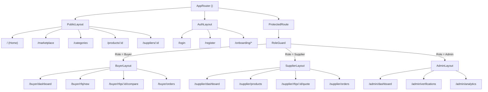

# COVERLY - Frontend Application Architecture & Component Contract

This document outlines the frontend engineering architecture for COVERLY, built on **React 18**, **Vite 6**, **TypeScript**, **Tailwind CSS v3.4**, and **React Router v6**.

---

## 1. Architectural Principles

1. **Strict Separation of Concerns**: Pages manage layout composition and route parameters; container components orchestrate state and API services; presentation components remain purely deterministic and reusable.
2. **Context-Driven Role Security**: Application routes are wrapped with `ProtectedRoute` and `RoleGuard` components that intercept unauthorized navigation before DOM rendering.
3. **Optimistic & Resilient Data Fetching**: API operations maintain loading states, error boundaries, and cache fallbacks.
4. **Design Token Consistency ("Warm Ledger")**: Zero hardcoded hex colors or arbitrary spacing; all components strictly inherit CSS tokens defined in `src/index.css` and mapped in `tailwind.config.ts`.
5. **Mobile-First Responsiveness**: All tables, comparison matrices, and multi-step forms degrade gracefully to thumb-friendly mobile layouts on viewports $< 768\text{px}$.

---

## 2. Directory Layout & Module Organization

```text
frontend/src/
├── assets/                     # Logos, static illustrations, icons
├── components/                 # Reusable UI component library
│   ├── common/                 # Badges, buttons, loaders, stat cards, dialogs
│   ├── forms/                  # Form inputs, selects, dropzones, quantity counters
│   ├── cards/                  # ProductCard, SupplierCard, RfqCard, QuoteCard, OrderCard
│   ├── tables/                 # DataTable, Pagination, SortHeader, EmptyTableState
│   ├── modals/                 # ConfirmModal, QuickRfqModal, InquiryChatModal
│   ├── navigation/             # Navbar, BuyerSidebar, SupplierSidebar, AdminSidebar
│   ├── marketplace/            # CategoryFilterRail, PriceFilter, SearchBar
│   ├── rfq/                    # RfqWizard, ItemSpecBuilder, SupplierMatcher
│   ├── quotations/             # LandedCostMatrix, QuoteBreakdown, IllusionBanner
│   └── orders/                 # OrderMilestoneStepper, LogisticsCard, SignoffDialog
├── layouts/                    # Layout shells
│   ├── PublicLayout.tsx        # Public Navbar + Content + Footer
│   ├── AuthLayout.tsx          # Minimalist centered branding shell
│   ├── BuyerLayout.tsx         # Buyer Sidebar + Topbar + Workspace Switcher
│   ├── SupplierLayout.tsx      # Supplier Sidebar + Topbar + Verification Status
│   └── AdminLayout.tsx         # Admin Sidebar + Audit Alerts + Topbar
├── pages/                      # Page views mapped to routing tree
│   ├── public/                 # Home, Categories, Marketplace, ProductDetails, About, Contact
│   ├── auth/                   # Register, Login, ForgotPassword, RoleSelection, Onboarding
│   ├── buyer/                  # Dashboard, Discover, RFQ creation, Comparison, Orders
│   ├── supplier/               # Dashboard, Catalog, RFQ feed, Quote builder, Order pipeline
│   ├── admin/                  # Governance, Verification queue, Analytics, Audit logs
│   └── shared/                 # Notifications, Profile, Settings, AccessDenied, NotFound
├── routes/                     # Route definitions and security wrappers
│   ├── AppRouter.tsx           # Master Router configuration
│   ├── ProtectedRoute.tsx      # JWT session gatekeeper
│   └── RoleGuard.tsx           # Role capability gatekeeper
├── contexts/                   # Global React Context providers
│   ├── AuthContext.tsx         # Session state, user identity, login/logout handlers
│   ├── RoleContext.tsx         # Active workspace toggle ('buyer' vs 'supplier')
│   └── NotificationContext.tsx # In-app notification polling and live counter
├── services/                   # Typed API clients communicating with backend
│   ├── api.ts                  # Axios / Fetch base client with JWT interceptors
│   ├── authApi.ts              # Login, register, session refresh
│   ├── businessApi.ts          # Onboarding, verification upload, business profile
│   ├── productApi.ts           # Catalog queries, product CRUD, search
│   ├── rfqApi.ts               # RFQ creation, recipient dispatch, matching
│   ├── quotationApi.ts         # Quote submission, comparison calculations, acceptance
│   ├── orderApi.ts             # Order lifecycle, milestone transitions, tracking
│   └── adminApi.ts             # Moderation, verification audit decisions, analytics
├── types/                      # Shared TypeScript interface definitions
│   ├── auth.types.ts
│   ├── business.types.ts
│   ├── product.types.ts
│   ├── rfq.types.ts
│   ├── quotation.types.ts
│   └── order.types.ts
├── utils/                      # Formatting helpers (formatRupees, formatPercent, cn)
├── App.tsx                     # Master component mounting Providers and Router
├── main.tsx                    # React 18 createRoot mounting point
└── index.css                   # Tailwind imports and Warm Ledger design tokens
```

---

## 3. Router Hierarchy & Route Protection Architecture



### Route Guard Implementation
```tsx
// RoleGuard.tsx snippet
export function RoleGuard({ allowedRoles, children }: { allowedRoles: string[]; children: ReactNode }) {
  const { user, loading } = useAuth();
  const { activeWorkspace } = useRole();

  if (loading) return <FullScreenSpinner />;
  if (!user) return <Navigate to="/login" replace />;

  const hasPermission = user.roles.some((r) => allowedRoles.includes(r)) || user.roles.includes('admin');

  if (!hasPermission) {
    return <Navigate to="/access-denied" replace />;
  }

  return <>{children}</>;
}
```

---

## 4. Design System Tokens ("Warm Ledger")

All tokens are defined in `src/index.css` and mapped in `tailwind.config.ts`:

| Token | Class | Hex Value | Purpose |
| :--- | :--- | :--- | :--- |
| **Canvas Start** | `bg-canvas-start` | `#F9DCD8` | Top page background gradient |
| **Canvas End** | `bg-canvas-end` | `#F5EAE6` | Bottom page background gradient |
| **Surface** | `bg-surface` | `#FFFFFF` | Crisp white cards, modals, and tables |
| **Surface Muted** | `bg-surface-muted` | `#F6F7F9` | Secondary containers, table headers |
| **Surface Pink** | `bg-surface-pink` | `#FDECEB` | Metric cards, best landed cost rows |
| **Text Primary** | `text-ink` | `#22252A` | High-contrast headings and body copy |
| **Text Secondary** | `text-ink-secondary`| `#7A7F87` | Metadata, timestamps, table labels |
| **Navy Action** | `bg-navy` | `#1D2235` | Primary action pill buttons |
| **Coral Accent** | `bg-coral`, `text-coral`| `#F16A5A` | Lowest landed cost highlights & CTAs |
| **Verified Green** | `text-verified` | `#1F9D6B` | Verified badges and audit checkmarks |
| **WhatsApp** | `bg-whatsapp` | `#25D366` | Direct messaging buttons and webhooks |

---

## 5. Global State Management

- **`AuthContext`**: Manages authenticated session tokens, user profile metadata, sign-in, and logout triggers.
- **`RoleContext`**: Manages dual-role state for `buyer_supplier` accounts, tracking whether the user is actively viewing their Buyer Workspace or Supplier Workspace.
- **`NotificationContext`**: Polls `/api/notifications` every 60 seconds (with backoff) and manages active unread counters in the navigation bar.
- **Server Cache & Forms**: Component-level React hooks (`useState`, `useReducer`, `useEffect`) manage form wizard state and ephemeral search filters.
