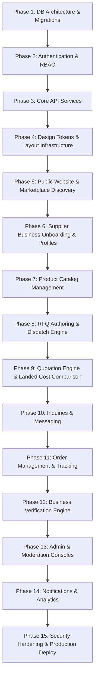

# COVERLY — Implementation Roadmap & Gap Analysis

This document provides a comprehensive audit of the current codebase against the full product specification, identifying all architectural and feature gaps across 20 core modules, followed by a phased 15-stage implementation roadmap with strict delivery gates.

---

## 1. Comprehensive Gap Analysis (20 Modules)

| # | Module | Specification Requirement | Current State | Gap & Remediation Required |
|---|---|---|---|---|
| **1** | **Identity & Role Management** | 9 distinct roles (`guest`, `buyer`, `manufacturer`, `wholesaler`, `distributor`, `buyer_supplier`, `admin`, `verification_admin`, `support_admin`) with dynamic context switching for dual roles. | Basic InsForge Auth configured; base `user_roles` concept defined in documentation. | Implement `user_roles` table, JWT custom claims / role resolver middleware, and frontend `RoleContext` with workspace switcher. |
| **2** | **Business Onboarding** | Multi-step role-specific onboarding forms collecting GSTIN, PAN, factory specifications, production capacity, logistics coverage. | Static lead capture form for concierge on homepage. | Create dedicated onboarding routes (`/auth/onboarding/*`), step validation schemas, and database inserts into `businesses`, `buyer_profiles`, `supplier_profiles`. |
| **3** | **Product Catalog** | Tiered categories/subcategories, MOQ, tiered volume pricing, HS codes, specs, and multi-image galleries. | Static mock array of featured products in landing page. | Implement `categories`, `subcategories`, `products`, and `product_images` tables with full CRUD APIs and dynamic catalog views. |
| **4** | **Discovery & Search** | Full-text search with faceted filters (category, location, MOQ, business type, verification level, price band). | Keyword search input on landing page that filters local state. | Implement server-side search API with PostgreSQL `ilike` and tsvector/GIN indexing, coupled with a faceted search UI. |
| **5** | **Supplier Directory** | Dedicated directory views for Manufacturers, Wholesalers, and Distributors with capability badges and verified status. | Single supplier listing cards on landing page. | Build `/manufacturers`, `/wholesalers`, `/distributors`, and `/suppliers/:slug` profile pages with live database querying. |
| **6** | **RFQ Engine** | Structured RFQ authoring (line items, target prices, delivery pincodes, delivery timelines, attachments) with direct and broadcast modes. | Concierge RFQ lead capture modal. | Implement `rfqs`, `rfq_items`, and `rfq_recipients` tables, multi-step RFQ creation wizard, and supplier broadcast matching algorithm. |
| **7** | **Quotation Engine** | Multi-item quotation builder with itemized unit pricing, freight, GST breakdown, validity windows, and terms. | Non-existent in app code. | Implement `quotations`, `quotation_items`, and `quotation_costs` tables with supplier submission interface and status lifecycles. |
| **8** | **Landed Cost Engine** | Multi-quote comparison matrix computing base cost, GST, freight, insurance, packaging, and unit landed cost. | Core calculation formulas tested in `landed-cost.test.ts`. | Connect calculation engine to live database quotations and build the dynamic quotation comparison matrix UI. |
| **9** | **Inquiry & Clarification** | Contextual threaded Q&A attached directly to RFQs and quotations between buyer and supplier. | Non-existent. | Implement `inquiry_threads` and `inquiry_messages` with optimistic UI and live polling/realtime updates. |
| **10** | **Order Management** | Single-click order conversion upon quotation acceptance, deposit handling, PO generation, and milestone tracking. | Non-existent. | Implement `orders`, `order_items`, and `order_status_history` tables with state machine (`pending_deposit` $\to$ `in_production` $\to$ `shipped` $\to$ `delivered` $\to$ `completed`). |
| **11** | **Fulfillment & Tracking** | Milestone-based status updates, tracking numbers, dispatch proof document uploads, and buyer delivery sign-off. | Non-existent. | Build order tracking timeline view, dispatch update modals, and delivery confirmation flows. |
| **12** | **Business Verification** | 4 distinct verification tiers (`phone_verified`, `email_verified`, `document_verified`, `registration_checked`) with document uploads. | Mock "Verified" badges in UI without backing checks. | Implement `supplier_verifications` and `verification_documents` tables with secure document uploads via InsForge storage. |
| **13** | **Superadmin Console** | Global KPI dashboard, user/business management, platform-wide RFQ/quotation/order oversight, and system settings. | Non-existent. | Build `/admin/*` views with aggregated metric queries and moderation actions (suspend/activate, delete). |
| **14** | **Verification Admin Portal** | Dedicated review queue for pending business verifications, document inspection viewer, and tier granting/rejection. | Non-existent. | Build `/admin/verifications` queue with side-by-side document preview, rejection reason modal, and audit stamping. |
| **15** | **Support Ticket System** | Helpdesk ticketing system with priorities, category routing, threaded responses, and status lifecycles. | Basic footer contact link. | Implement `support_tickets` and `ticket_messages` tables with buyer/supplier submission form and admin resolution dashboard. |
| **16** | **Audit Logging** | Immutable append-only log of all administrative actions, verification decisions, and security events. | Non-existent. | Implement `admin_audit_logs` table with non-bypassable backend logging middleware and admin viewer. |
| **17** | **Notification Engine** | In-app notification center for RFQ updates, quote arrivals, order status changes, and verification outcomes. | Non-existent. | Implement `notifications` table, backend notification dispatcher service, and top-bar bell dropdown with read/unread state. |
| **18** | **Analytics & Metrics** | Real-time computed GMV, RFQ fulfillment velocity, supplier win rates, and buyer retention analytics. | Non-existent. | Implement PostgreSQL aggregation queries and backend `/api/admin/analytics` and `/api/suppliers/stats` endpoints. |
| **19** | **File Storage Architecture** | Secure InsForge Storage buckets for business documents, product images, and order dispatch slips with signed URLs. | Unconfigured. | Create InsForge storage buckets (`business-docs`, `product-images`, `order-attachments`) with RLS and MIME validation. |
| **20** | **Modular Expansions** | Non-invasive hooks for future business registration, government scheme discovery, and financing assistance. | Mentioned on landing page. | Implement isolated placeholder service cards with "Coming Soon / Inquire" modals, keeping core workflows strictly unblocked. |

---

## 2. 15-Phase Implementation Roadmap

### Phase 1: Database Architecture & InsForge Migrations
- **Milestones**:
  - Author complete SQL migration defining the 26 core tables, foreign keys, constraints, and audit timestamps.
  - Deploy migration using `npx @insforge/cli db migrations up`.
  - Configure PostgreSQL Row Level Security (RLS) policies for tenant isolation.
  - Create InsForge storage buckets (`business-docs`, `product-images`, `order-attachments`).
- **Delivery Gate**: Clean migration run with zero errors; schema inspect confirms all 26 tables present in PostgreSQL.

### Phase 2: Authentication, Authorization & RBAC
- **Milestones**:
  - Connect `@insforge/sdk` client auth in both frontend and backend.
  - Implement `/auth/register`, `/auth/login`, `/auth/forgot-password`, `/auth/reset-password`.
  - Implement role selection and role assignment in `user_roles`.
  - Create backend `authenticate` and `requireRole` middleware.
  - Implement frontend `AuthContext`, `RoleContext`, `ProtectedRoute`, and `RoleGuard`.
- **Delivery Gate**: Successful registration and login across all 9 roles; non-authorized routes return 403 Forbidden.

### Phase 3: Core Backend API Infrastructure
- **Milestones**:
  - Set up modular Express router structure under `backend/src/modules/`.
  - Add request validation middleware (Joi/Zod) and security middleware (`helmet`, `cors`, `express-rate-limit`).
  - Implement unified error handling middleware and standard JSON response envelopes (`success`, `data`, `error`).
- **Delivery Gate**: Automated test suite confirms 400 Bad Request on invalid payloads and 429 Too Many Requests on rate limit breach.

### Phase 4: Frontend Layouts, Router & Design Tokens
- **Milestones**:
  - Install `react-router-dom` v6 in `frontend/`.
  - Define complete route hierarchy covering all ~75 screen routes.
  - Implement layouts: `PublicLayout`, `AuthLayout`, `BuyerLayout`, `SupplierLayout`, `AdminLayout`.
  - Apply Warm Ledger design tokens across all shared UI components (buttons, badges, inputs, tables, modals).
- **Delivery Gate**: Route smoke tests navigate cleanly without page reloads or broken links; layout headers/sidebars render conditionally based on role.

### Phase 5: Public Marketplace & Supplier Discovery (Screens 1–12)
- **Milestones**:
  - Refactor existing landing page into modular sections using live data.
  - Implement Categories (`/categories`, `/categories/:slug`) with category hierarchy.
  - Implement Marketplace (`/products`, `/products/:id`) with live database catalog.
  - Implement Directories (`/manufacturers`, `/wholesalers`, `/distributors`).
  - Implement Public Supplier Profile (`/suppliers/:slug`).
  - Implement About and Contact pages.
- **Delivery Gate**: Unauthenticated users can search, filter, and view products and public supplier profiles.

### Phase 6: Supplier Business Onboarding & Profile Management (Screens 17–19, 42)
- **Milestones**:
  - Build multi-step onboarding wizard (`/auth/onboarding`) with role-specific forms.
  - Implement supplier profile editor (`/supplier/profile`) supporting factory details, certifications, and service regions.
  - Connect InsForge storage for logo and factory picture uploads.
- **Delivery Gate**: New supplier completes onboarding; profile record is created and editable in dashboard.

### Phase 7: Product Catalog Management (Screens 45–49)
- **Milestones**:
  - Implement My Products dashboard (`/supplier/products`).
  - Implement Add/Edit Product forms (`/supplier/products/new`, `/supplier/products/:id/edit`) with image upload, MOQ, tiered volume pricing, and specs.
  - Implement listing toggle (active/inactive/draft).
- **Delivery Gate**: Supplier can create and publish a product; product immediately appears in public marketplace search.

### Phase 8: RFQ Authoring & Dispatch Engine (Screens 28–31, 50–51)
- **Milestones**:
  - Implement multi-item RFQ creation wizard (`/buyer/rfq/new`) with target prices, attachments, and supplier selection.
  - Implement broadcast matching logic based on product category.
  - Implement Buyer RFQ list and details views (`/buyer/rfqs`, `/buyer/rfqs/:id`).
  - Implement Supplier Incoming RFQs queue (`/supplier/rfqs`, `/supplier/rfqs/:id`).
- **Delivery Gate**: Buyer submits RFQ $\to$ Matched suppliers see RFQ in their incoming queue with matching status `pending`.

### Phase 9: Quotation Engine & Landed Cost Comparison (Screens 32–34, 52–54)
- **Milestones**:
  - Implement Supplier Quotation builder (`/supplier/rfqs/:id/quote`) with itemized pricing, freight, GST, and terms.
  - Implement Buyer Received Quotations view (`/buyer/rfqs/:id/quotations`).
  - Implement Landed Cost Comparison Matrix (`/buyer/rfqs/:id/compare`) using verified calculation engine.
  - Implement Quote Acceptance workflow.
- **Delivery Gate**: 2+ suppliers quote on an RFQ $\to$ Buyer can view side-by-side comparison matrix with lowest landed cost highlighted.

### Phase 10: Inquiry Clarification & Communication (Screens 35, 55)
- **Milestones**:
  - Implement contextual inquiry threads attached to RFQs and Quotations.
  - Build real-time messaging UI with message history, document attachments, and timestamps.
- **Delivery Gate**: Buyer sends clarification message on RFQ $\to$ Supplier receives and responds; messages persist in thread.

### Phase 11: Order Management & Fulfillment Tracking (Screens 37–39, 56–58)
- **Milestones**:
  - Implement automatic Order generation upon quotation acceptance.
  - Build Buyer Order views (`/buyer/orders`, `/buyer/orders/:id`, `/buyer/orders/:id/track`).
  - Build Supplier Order Management (`/supplier/orders`, `/supplier/orders/:id`, `/supplier/orders/:id/status`).
  - Implement state transition validation and dispatch document uploads.
- **Delivery Gate**: Accepted quotation creates order $\to$ Supplier updates status to `shipped` with tracking number $\to$ Buyer confirms delivery $\to$ Order status updates to `completed`.

### Phase 12: Business Verification Engine (Screens 43–44, 65)
- **Milestones**:
  - Implement Supplier Verification submission view (`/supplier/verification`) with document upload for GSTIN, PAN, and business licenses.
  - Implement Verification Admin review queue (`/admin/verifications`) with approve/reject actions and notes.
  - Automatically update verification tier badges on public profiles.
- **Delivery Gate**: Document uploaded by supplier $\to$ Verification Admin reviews and approves $\to$ Profile badge updates to `document_verified`.

### Phase 13: Admin & Moderation Consoles (Screens 61–75)
- **Milestones**:
  - Build Superadmin Dashboard (`/admin`) with platform GMV, active users, and system health.
  - Build User, Buyer, and Supplier management tables with status toggle (active/suspended).
  - Build RFQ and Order oversight monitors.
  - Build Support Ticket console (`/admin/support`).
  - Implement immutable `admin_audit_logs` recording every admin action.
- **Delivery Gate**: Admin can search, filter, and suspend an account; action is recorded in audit logs with timestamp and admin ID.

### Phase 14: Notification Engine & Live Metrics (Screens 59, 73, shared)
- **Milestones**:
  - Build in-app notification center with read/unread markers and click-through deep links.
  - Implement Supplier Business Statistics (`/supplier/analytics`) with quote conversion rates.
  - Implement Platform Marketplace Analytics (`/admin/analytics`).
- **Delivery Gate**: Creating an RFQ generates notifications for targeted suppliers; clicking notification opens the exact RFQ.

### Phase 15: Security Hardening, Verification & Production Deployment
- **Milestones**:
  - Perform security audit on all endpoints and RLS policies.
  - Execute end-to-end integration tests across all 9 user workflows.
  - Run full TypeScript typecheck and production build.
  - Configure Vercel deployment variables and custom domain routing.
- **Delivery Gate**: Zero build warnings, zero typecheck errors, all automated tests passing, clean Vercel deployment.
