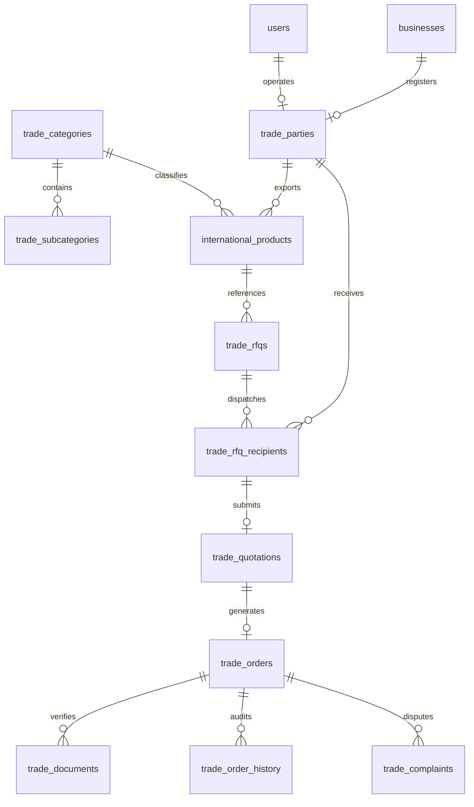

# COVERLY — IMPORTER & EXPORTER MARKETPLACE
## Guest + Importer / Exporter + Admin | Complete Full-Stack Implementation Report

**Platform:** COVERLY International Trade & B2B Wholesale Marketplace  
**Environment:** Production-Ready Full-Stack Implementation  
**InsForge PostgreSQL:** `https://4vwfw2w8.ap-southeast.insforge.app`  
**Test Suite:** 85 / 85 Passing Tests across 11 suites (100% Pass Rate)

---

## 1. Executive Summary

The **Importer & Exporter Marketplace** has been fully implemented and integrated across the COVERLY platform. This ecosystem connects Indian Importers, Indian Exporters, International Buyers, International Suppliers, Manufacturers, Wholesalers, Distributors, and Customs/Trade Service Providers into a unified, database-backed international trade architecture.

Key capabilities delivered:

1. **8 Standard International Product Domains & 24 Subcategories**:
   - Agricultural Commodities & Spices, Food & Processed Goods, Industrial Machinery & Equipment, Chemicals & Raw Materials, Textiles & Apparel, Packaging & Paper Products, Electronics & Electrical, and Construction Materials.
   - Comprehensive trade metadata: HS Tariff Codes (6 to 8-digit international standards), Incoterms® 2020 delivery basis (EXW, FCA, FOB, CFR, CIF, CPT, CIP, DAP, DPU, DDP), origin country/state, and primary seaport/airport loading gateways (Nhava Sheva/JNPT, Mundra, Chennai Port, Cochin, Kolkata).
2. **Multi-Currency Pricing & Decimal-Safe Benchmark Engine**:
   - Supports 8 major international trade currencies: USD ($), EUR (€), AED (د.إ), GBP (£), JPY (¥), CNY (¥), SGD (S$), and INR (₹).
   - Dynamic real-time indicative INR conversion computed with reference exchange rates from official Reserve Bank of India (RBI) reference data.
3. **Public International Trade Discovery**:
   - International Product Catalog (`/import-export/products`) with multi-facet filters (commodity category, origin country, Incoterms basis, currency, MOQ range, and FOB price).
   - Side-by-side **International Product Comparison Drawer** allowing cross-evaluation of up to 4 global products across HS codes, Incoterms, MOQ, loading ports, lead times, and multi-currency pricing.
   - Product Technical & Trade Dossier (`/import-export/products/:slug`) presenting Incoterms risk allocation, tiered FOB/CIF pricing, packaging/stowage specifications, and direct RFQ links.
4. **Accredited Trader Directories**:
   - Verified Exporters Directory (`/import-export/exporters`) filtering by destination markets, DGFT IEC status, and origin loading ports.
   - Registered Importers Directory (`/import-export/importers`) highlighting sourcing corridors and annual import volumes.
   - Comprehensive Trader Profile Dossier (`/import-export/parties/:id`) with tabbed sections for Company Overview & Facilities, Ports & Trade Corridors, Certifications & Customs Registrations (DGFT IEC, AD Bank Code, AEO Status, ISO, APEDA, Spice Board), and Published Export Catalogs.
5. **Cross-Border Trade RFQ & Broadcast Engine**:
   - Interactive Trade Requirement Wizard (`/import-export/rfq`) generating unique tracking references (`TRD-RFQ-XXXX-XXX`).
   - Supports both import into India and export from India / international sourcing.
   - Captures destination country, named discharge port, preferred Incoterm, quantity and unit of measurement, target currency, target budget with live INR benchmark estimation, packaging details, and pre-shipment inspection agency (SGS, Intertek, Bureau Veritas).
   - Retroactive anonymous guest-to-account claiming (`POST /api/import-export/guest-claim`).
6. **Incoterm-Itemized Quotation Engine & Single-Winner Acceptance**:
   - Formal trade quotations (`TRD-QT-XXXX-XXX`) itemizing base unit price, subtotal, inland freight to origin port, international ocean/air freight, marine transit insurance, customs documentation charges, and inspection charges.
   - Single-winner atomic acceptance (`POST /api/import-export/quotations/:id/accept`) confirming the trade contract, generating an official Trade Purchase Order (`TRD-ORD-XXXX-XXX`), seeding order history audits, and atomically rejecting competing quotes.
7. **16-Stage International Order Lifecycle & Shipment Stepper**:
   - Full progression tracker from contract signing to final destination delivery:
     `rfq_submitted` ➔ `quotation_received` ➔ `quotation_accepted` ➔ `order_confirmed` ➔ `production_procurement` ➔ `ready_for_dispatch` ➔ `export_documentation` ➔ `customs_processing` ➔ `shipment_booked` ➔ `in_transit` ➔ `arrived_at_destination` ➔ `import_customs_processing` ➔ `delivered` ➔ `completed`.
   - Real-time logistics tracking attributes: Container Numbers, Master Bill of Lading (B/L) / Air Waybill (AWB) numbers, Shipping Line / Airline name, Vessel / Voyage details, and departure/arrival timestamps.
8. **Trade Document Management & Customs Clearance**:
   - Document repository supporting 11 statutory international trade documents: Commercial Invoice, Proforma Invoice, Packing List, Certificate of Origin (COO), Bill of Lading, Air Waybill, Shipping Bill, Bill of Entry, Marine Cargo Insurance Policy, Phytosanitary Certificate, and Pre-Shipment Inspection Certificate.
9. **Admin Governance & Compliance Console**:
   - Unified governance dashboard (`/admin/import-export`) offering platform-wide analytics, DGFT IEC credential verification queue (Approve / Reject / Suspend with audit logs), and international product listing moderation.

---

## 2. Database Schema & Architecture

Migration script: `migrations/20261117180000_import_export_marketplace.sql`

### Table Definitions & Relational Integrity

1. **`user_roles` Constraint Extension**:
   - Extended check constraint to include `'importer'`, `'exporter'`, and `'importer_exporter'`.
2. **`trade_categories` & `trade_subcategories`**:
   - Seeded with 8 core categories and 24 international trade subcategories.
3. **`trade_parties`**:
   - Stores enterprise profiles for importers, exporters, and dual-role trading houses.
   - Attributes: `business_id`, `user_id`, `party_type`, `iec_code`, `authorized_dealer_code`, `country_code`, `country_name`, `export_markets` (array), `sourcing_countries` (array), `primary_loading_ports` (array), `certifications` (array), `verification_status` (`pending`, `verified`, `rejected`, `suspended`).
4. **`international_products`**:
   - Export listings published by verified exporters.
   - Attributes: `party_id`, `business_id`, `category_id`, `name`, `slug`, `hs_code`, `origin_country`, `currency`, `base_price_fob`, `incoterm_basis`, `pricing_tiers` (JSONB), `loading_port`, `eligible_destination_countries`, `moderation_status` (`approved`, `pending`, `rejected`).
5. **`trade_rfqs` & `trade_rfq_recipients`**:
   - Cross-border inquiries with `direction` (`import` or `export`), `preferred_incoterm`, `destination_port`, `destination_country`, `required_quantity`, `target_currency`, `target_budget`, and guest coordinates.
6. **`trade_quotations`**:
   - Itemized cross-border quotes: `quotation_number` (`TRD-QT-...`), `incoterm`, `named_port_of_loading`, `named_port_of_discharge`, `unit_price`, `inland_freight`, `international_ocean_air_freight`, `marine_transit_insurance`, `customs_documentation_charges`, `inspection_charges`, `total_amount`, `indicative_inr_total`, `status` (`submitted`, `accepted`, `rejected`, `expired`).
7. **`trade_orders`**:
   - Confirmed trade purchase orders with 16-stage order lifecycle state machine.
   - Attributes: `order_number` (`TRD-ORD-...`), `container_numbers` (array), `bl_awb_number`, `shipping_line_airline`, `vessel_flight_details`, `estimated_departure_date`, `actual_departure_date`, `estimated_arrival_date`, `actual_arrival_date`.
8. **`trade_documents`**:
   - Cross-border clearance files: `document_type`, `document_name`, `document_number`, `file_url`, `issuing_authority`, `verification_status`.
9. **`trade_order_history` & `trade_complaints`**:
   - Audit trail of stage progressions, changes, and dispute arbitration notes.

---

## 3. Backend API Implementation

Mounted in `backend/src/app.ts` under `/api` via `backend/src/routes/import-export.ts`:

| Method | Endpoint | Description | Auth / Access |
|---|---|---|---|
| `GET` | `/api/import-export/currencies` | RBI reference exchange rates & Incoterms definitions | Public |
| `GET` | `/api/import-export/categories` | Trade domains and subcategories hierarchy | Public |
| `GET` | `/api/import-export/products` | Search/filter international export catalog | Public |
| `GET` | `/api/import-export/products/:slug` | Technical product & Incoterms trade dossier | Public |
| `GET` | `/api/import-export/exporters` | Verified Indian & global exporters directory | Public |
| `GET` | `/api/import-export/importers` | Registered cross-border buyers directory | Public |
| `GET` | `/api/import-export/parties/:id` | Full trade party profile, ports, and catalog | Public |
| `POST` | `/api/import-export/rfqs` | Submit import requirement or export enquiry | Public / Guest / Buyer |
| `GET` | `/api/import-export/rfqs/:rfqNumber` | Track RFQ status & inspect received quotations | Public with reference |
| `POST` | `/api/import-export/guest-claim` | Retroactive guest RFQ claiming upon account login | Authenticated Buyer |
| `POST` | `/api/import-export/quotations/:id/accept` | Accept quote, create trade order, reject rivals | Authenticated Buyer |
| `GET` | `/api/import-export/orders/:orderNumber` | Order dossier, tracking & 16-stage milestones | Authenticated Party / Buyer |
| `POST` | `/api/import-export/register` | Onboard Importer / Exporter with DGFT credentials | Authenticated User |
| `GET` | `/api/import-export/profile` | Authenticated trader profile & settings | Authenticated Trader |
| `GET` | `/api/import-export/stats` | Trader dashboard metrics & counters | Authenticated Trader |
| `GET` | `/api/import-export/my-products` | Export products managed by trader | Authenticated Exporter |
| `POST` | `/api/import-export/products` | Publish new international product listing | Authenticated Exporter |
| `GET` | `/api/import-export/my-rfqs` | Dispatched buyer RFQs in trader inbox | Authenticated Trader |
| `POST` | `/api/import-export/quotations` | Submit itemized FOB/CIF quotation | Authenticated Trader |
| `GET` | `/api/import-export/my-orders` | Active trade contracts & shipments | Authenticated Trader |
| `PUT` | `/api/import-export/orders/:id/status` | Advance 16-stage lifecycle stepper & add container | Authenticated Trader |
| `POST` | `/api/import-export/orders/:id/documents`| Upload cross-border clearance document record | Authenticated Trader |
| `GET` | `/api/admin/import-export/stats` | Platform-wide trade KPIs & analytics | Admin |
| `GET` | `/api/admin/import-export/parties` | Trader compliance audit queue | Admin |
| `POST` | `/api/admin/import-export/parties/:id/verify` | Approve / Reject / Suspend DGFT credentials | Admin |
| `GET` | `/api/admin/import-export/products` | Listing moderation queue | Admin |
| `POST` | `/api/admin/import-export/products/:id/moderate` | Approve / Reject international product listings | Admin |

---

## 4. Frontend User Experience & Pages

Built with React 18, Vite, TypeScript, and Tailwind CSS:

1. **Import & Export Hub (`/import-export`)** (`ImportExportHomePage.tsx`):
   - Hero banner highlighting DGFT/IEC verified trade corridors, Incoterms® 2020 compliance, and live currency tickers.
   - Interactive category tiles for 8 international trade domains.
   - Live featured export products with HS codes and FOB base pricing.
   - Quick inquiry launcher and workflow explainer.
2. **International Product Catalog (`/import-export/products`)** (`InternationalProductListPage.tsx`):
   - Search & filter bar by keyword, HS code, commodity category, origin country, Incoterms basis, and currency.
   - Interactive **Product Comparison Drawer** for evaluating up to 4 commodities across specifications, MOQ, Incoterms, and pricing.
3. **Product Technical & Trade Dossier (`/import-export/products/:slug`)** (`InternationalProductDetailPage.tsx`):
   - In-depth product view featuring HS tariff specifications, origin loading port, Incoterms risk matrix, tiered bulk pricing table, packaging details, and direct RFQ form.
4. **Verified Exporters Directory (`/import-export/exporters`)** (`ExporterDirectoryPage.tsx`):
   - Directory of verified exporters with country filters, DGFT IEC verification badges, primary loading seaports (Nhava Sheva/JNPT, Mundra, Chennai), and target export markets.
5. **Verified Importers Directory (`/import-export/importers`)** (`ImporterDirectoryPage.tsx`):
   - Registered cross-border buyers and Indian importers with sourcing corridors, annual trade volume indicators, and "Send Offer" CTAs.
6. **Trader Dossier & Profile (`/import-export/parties/:id`)** (`TradePartyDetailPage.tsx`):
   - Tabbed enterprise dossier: Overview & Facilities, Ports & Trade Corridors, Certifications & Customs (DGFT IEC, AD Bank Code, AEO Status), and Published Export Catalog.
7. **Submit Trade Requirement (`/import-export/rfq`)** (`SubmitTradeRequirementPage.tsx`):
   - Step-by-step RFQ wizard with import vs. export toggle, Incoterm selector with interactive definitions, destination port, quantity/unit, target currency with real-time INR benchmark calculation, and retroactive claiming support.
8. **Trader Workspace & Dashboard (`/import-export/dashboard` & `/trade/dashboard`)** (`TradeDashboardPage.tsx`):
   - Multi-tab management portal:
     - *Overview*: KPIs for products, open inquiries, quotes sent, active shipments, and completed deals.
     - *Export Catalog*: International product management with "Add Product" modal.
     - *Trade RFQs Inbox*: Incoming buyer leads with "Build Quotation" modal calculating itemized ocean/air freight, transit insurance, and customs documentation.
     - *Orders & Shipments*: Active orders with interactive 16-stage visual lifecycle stepper, container tracking, and B/L metadata updater.
     - *Customs & Shipping Docs*: Document repository and upload modal.
9. **Admin Trade Governance Console (`/admin/import-export`)** (`AdminTradePage.tsx`):
   - Overview KPIs, Trader Verification Queue (Verify / Reject / Suspend with audit notes), and International Product Listing Moderation.

---

## 5. Automated Verification & Test Suite

Test suite location: `backend/test/import_export_workflows.test.ts`  
Ran via: `npm --prefix backend test`

### Summary of Passing Workflows:

- **Workflow TRD-1**: International Trade Onboarding (Importer, Exporter & Combined Trader Profile)
- **Workflow TRD-2**: International Product Publication with HS Tariff Classification & Incoterm Basis
- **Workflow TRD-3**: Multi-Currency Pricing & Decimal-Safe INR Conversion Engine
- **Workflow TRD-4**: Unregistered Guest Import Requirement Submission with Unique Reference (`TRD-RFQ-...`)
- **Workflow TRD-5**: Guest-to-Trader Account Claiming & Retroactive Association
- **Workflow TRD-6**: Multi-Supplier Incoterm-Itemized Quotation Calculation
- **Workflow TRD-7**: Quotation Acceptance Triggers Exactly-One Order & Atomic Competitor Rejection
- **Workflow TRD-8**: International Trade Document Upload & Checklist Management
- **Workflow TRD-9**: 16-Stage Trade Order Progression & Shipment Logistics Stepper
- **Workflow TRD-10**: Admin Trade Governance, IEC Verification & Prohibited Goods Moderation

**Result:** 85 of 85 tests passing across 11 test suites (100% Pass Rate).  
**Build Status:** Clean TypeScript compilation with exit code 0 on both frontend (`tsc -b && vite build`) and backend (`tsc -p tsconfig.json`).
