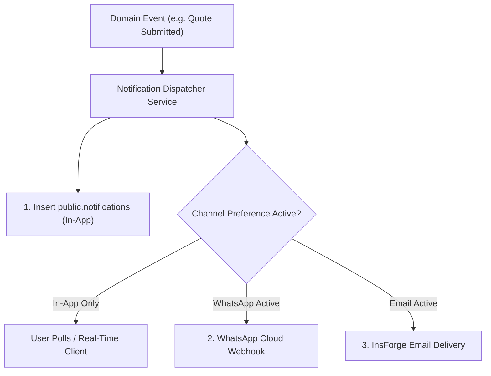

# COVERLY - Notification Engine & Event Catalog

This document defines the notification architecture for COVERLY. The system initiates with a real-time **In-App Notification Ledger** (`public.notifications`) and supports modular delivery adapters for **WhatsApp Business Webhooks** and **Transactional Email**.

---

## 1. Notification Architecture



---

## 2. Event Catalog by Persona

### Section A: Buyer Notifications

| Event Code | Trigger Condition | Notification Title | In-App Message Template | Action Destination |
| :--- | :--- | :--- | :--- | :--- |
| `BUYER_RFQ_SUBMITTED` | Buyer confirms RFQ | RFQ Dispatched | "RFQ `{{rfq_code}}` has been submitted and is matching with verified suppliers." | `/buyer/rfqs/{{rfq_id}}` |
| `BUYER_RFQ_MATCHED` | Suppliers matched | RFQ Sent to Suppliers | "RFQ `{{rfq_code}}` dispatched to `{{recipient_count}}` verified suppliers." | `/buyer/rfqs/{{rfq_id}}` |
| `BUYER_QUOTE_RECEIVED`| Supplier quotes | New Quotation Received | "`{{supplier_name}}` submitted a quotation for `{{rfq_code}}` at ₹`{{landed_unit}}`/unit landed." | `/buyer/rfqs/{{rfq_id}}/compare` |
| `BUYER_SUPPLIER_INQUIRY`| Supplier messages | Supplier Inquiry | "`{{supplier_name}}` sent a question regarding RFQ `{{rfq_code}}`." | `/buyer/inquiries/{{rfq_id}}/{{supplier_id}}` |
| `BUYER_ORDER_CONFIRMED` | Supplier confirms | Order Confirmed | "PO `{{po_code}}` confirmed by `{{supplier_name}}`. Production commenced." | `/buyer/orders/{{order_id}}` |
| `BUYER_ORDER_DISPATCHED`| Supplier dispatches | Consignment Dispatched | "PO `{{po_code}}` is in-transit with `{{carrier_name}}`. Vehicle: `{{vehicle_number}}`." | `/buyer/orders/{{order_id}}/tracking` |
| `BUYER_ORDER_DELIVERED` | Consignment arrives | Consignment Delivered | "Consignment for PO `{{po_code}}` delivered. Please inspect and confirm sign-off."| `/buyer/orders/{{order_id}}` |

### Section B: Supplier Notifications

| Event Code | Trigger Condition | Notification Title | In-App Message Template | Action Destination |
| :--- | :--- | :--- | :--- | :--- |
| `SUPPLIER_RFQ_OPPORTUNITY` | Matched with new RFQ | New RFQ Opportunity | "New RFQ for `{{quantity}}` `{{unit}}` `{{category_name}}` to `{{city}}`. Quoting closes in 48h." | `/supplier/rfqs/{{rfq_id}}/quote` |
| `SUPPLIER_RFQ_DEADLINE`| 12h before expiry | RFQ Deadline Approaching | "RFQ `{{rfq_code}}` closing soon. Submit your landed quote to compete." | `/supplier/rfqs/{{rfq_id}}/quote` |
| `SUPPLIER_BUYER_INQUIRY` | Buyer messages | Buyer Inquiry | "`{{buyer_name}}` sent a message regarding RFQ `{{rfq_code}}`." | `/supplier/inquiries/{{rfq_id}}` |
| `SUPPLIER_QUOTE_ACCEPTED`| Buyer accepts quote | Quotation Accepted! | "Congratulations! `{{buyer_name}}` accepted quote `{{quote_code}}`. New PO issued." | `/supplier/orders/{{order_id}}` |
| `SUPPLIER_DISPATCH_REMINDER` | Lead time expires | Dispatch Reminder | "PO `{{po_code}}` is due for dispatch today. Please update consignment telemetry." | `/supplier/orders/{{order_id}}` |
| `SUPPLIER_ORDER_COMPLETED` | Buyer signs off | Order Completed | "PO `{{po_code}}` signed off by buyer. Transaction marked completed." | `/supplier/orders/{{order_id}}` |

### Section C: Administrative Notifications

| Event Code | Trigger Condition | Target Role | Message Template | Action Destination |
| :--- | :--- | :--- | :--- | :--- |
| `ADMIN_VERIFICATION_SUBMITTED`| Supplier submits dossier | `verification_admin` | "`{{business_name}}` submitted a Level `{{requested_level}}` verification request." | `/admin/verifications` |
| `ADMIN_REPORT_FILED` | User reports issue | `support_admin` | "New dispute/report filed for PO `{{po_code}}`: `{{issue_type}}`." | `/admin/reports` |
| `ADMIN_PRICE_ANOMALY` | Quote variance $> 40\%$ | `admin` | "High price anomaly detected on Quote `{{quote_code}}` (Variance: `{{variance}}`%)." | `/admin/quotations` |
| `ADMIN_SUPPORT_ESCALATED` | Ticket SLA breached | `admin` | "Support ticket #`{{ticket_id}}` unaddressed for $> 24$ hours. Escalation triggered." | `/admin/support` |

---

## 3. Database Schema & Polling Strategy

Notifications are stored in `public.notifications`:

```sql
CREATE TABLE public.notifications (
  id UUID PRIMARY KEY DEFAULT gen_random_uuid(),
  user_id UUID NOT NULL REFERENCES public.users(id) ON DELETE CASCADE,
  title TEXT NOT NULL,
  message TEXT NOT NULL,
  notification_type TEXT NOT NULL,
  action_url TEXT,
  is_read BOOLEAN NOT NULL DEFAULT false,
  metadata JSONB NOT NULL DEFAULT '{}'::jsonb,
  created_at TIMESTAMPTZ NOT NULL DEFAULT NOW()
);

CREATE INDEX idx_notifications_user_unread 
  ON public.notifications(user_id, is_read, created_at DESC);
```

### Polling & Real-Time Sync
1. The frontend `NotificationContext` issues a light probe:
   ```http
   GET /api/notifications/unread-count
   ```
2. When the count increments, the notification list is updated:
   ```http
   GET /api/notifications?limit=20
   ```
3. Clicking a notification dispatches:
   ```http
   PATCH /api/notifications/:id/read
   ```
   and immediately navigates the user to `action_url`.
