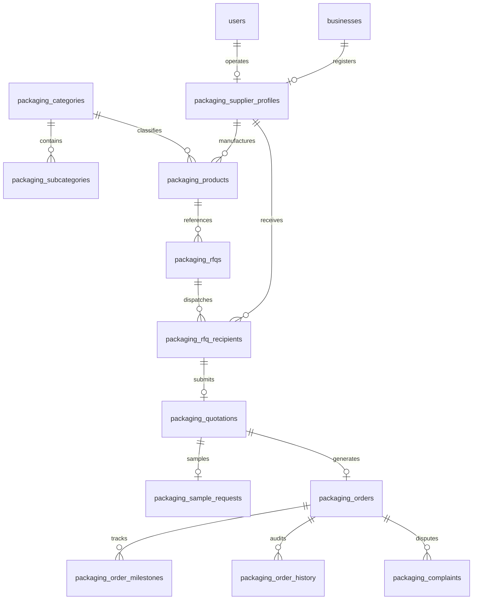
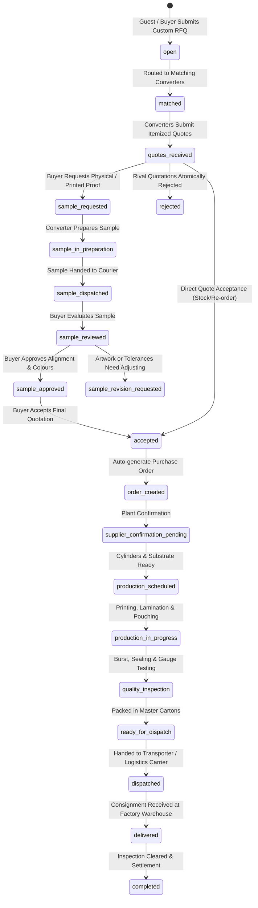

# COVERLY — PACKAGING SUPPLIER MARKETPLACE
## Guest + Packaging Supplier + Admin | Complete Full-Stack Implementation Report

**Platform:** COVERLY B2B Wholesale, Manufacturing & Packaging Marketplace  
**Environment:** Production-ready Full-Stack Implementation  
**InsForge PostgreSQL:** `https://4vwfw2w8.ap-southeast.insforge.app`  
**Test Suite:** 75 / 75 Passing Tests across 10 suites (100% Pass Rate)

---

## 1. Executive Summary

The **Packaging Supplier Marketplace** has been fully implemented and integrated across the COVERLY platform. This system connects commercial businesses, FMCG brands, e-commerce sellers, and factories with packaging manufacturers, custom converters, printing specialists, and material suppliers across India.

Key capabilities delivered:

1. **9 Standard Packaging Categories with Structured Subcategories**:
   - Comprehensive taxonomies: Flexible Packaging, Rigid Packaging, Paper Packaging, Corrugated Packaging, Food Packaging, Industrial Packaging, Labels and Printing, Protective Packaging, Packaging Accessories.
   - Category-specific specification blueprints (microns, barrier OTR/WVTR, zipper and seal type for pouches; ply count, flute type, GSM, burst factor for corrugated cartons; neck size, resin type, closure for bottles; adhesive, finish, roll format for labels).
2. **Public Packaging Directory & Technical Product Discovery**:
   - Searchable product directory (`/packaging/products`) with multi-facet filters (category, material substrate, thickness, dimensions, MOQ, price, and location).
   - Side-by-side **Technical Comparison Drawer** allowing simultaneous evaluation of up to 4 packaging products across dimensions, thickness, capacity, material structure, printing options, MOQ, base price, and lead time.
3. **Accredited Converter & Supplier Directory**:
   - Registered supplier index (`/packaging/suppliers`) with verification badges, factory location details, printing capabilities, certifications, and product catalogs.
   - Supplier profile dossier (`/packaging/suppliers/:id`) detailing converting facilities, printing technologies (rotogravure, flexo, digital roll labels), quality accreditations (ISO 9001, BRCGS, US FDA food contact), and catalog.
4. **Custom Packaging Requirements & RFQ System**:
   - Frictionless custom requirement submission (`PKG-RFQ-XXXX-XXX`) for unregistered guests and authenticated buyers.
   - Captures product being packed, material preferences, custom dimensions (length, width, height, gusset), quantity, printing/branding details, finishing requirements, food contact grade suitability, target budget, and reference design files.
   - Retroactive guest-to-buyer claiming (`POST /api/packaging/guest-claim`).
5. **Itemized Landed Cost Quotation Engine**:
   - Formal quotations (`PKG-QT-XXXX-XXX`) with transparent landed cost breakdowns: base unit price, tiered bulk discount, high-definition printing charges, plate/cylinder tooling charges, design charges, packaging charges, freight charges, and decimal-safe 18% GST calculation.
6. **Optional Sample & Approval Workflow**:
   - End-to-end sample lifecycle tracking (`PKG-SMP-XXXX-XXX`): `sample_requested` ➔ `sample_in_preparation` ➔ `sample_dispatched` (with tracking number) ➔ `sample_reviewed` ➔ `sample_approved` / `sample_revision_requested` before mass production confirmation.
7. **Single-Winner Quotation Acceptance & 13-Stage Production Stepper**:
   - Atomic acceptance: confirms chosen quote, creates purchase order (`PKG-ORD-XXXX-XXX`), seeds production milestones, rejects rival quotes atomically, and guards against expired or duplicate quotes.
   - 13-stage order lifecycle: `order_created` ➔ `supplier_confirmation_pending` ➔ `specifications_awaiting_approval` ➔ `sample_pending` ➔ `sample_approved` ➔ `production_scheduled` ➔ `production_in_progress` ➔ `quality_inspection` ➔ `ready_for_dispatch` ➔ `dispatched` ➔ `delivered` ➔ `completed`.
8. **Admin Governance & Verification Console**:
   - Comprehensive portal (`/admin/packaging`) providing platform-wide KPIs, converter credential verification (Approve / Reject / Suspend with audit logs), and technical product listing moderation.

---

## 2. Database Schema & Architecture

Migration script: `migrations/20261117170000_packaging_supplier_marketplace.sql`



### Table Definitions:

1. **`packaging_categories` & `packaging_subcategories`**:
   - 9 core categories: Flexible Packaging, Rigid Packaging, Paper Packaging, Corrugated Packaging, Food Packaging, Industrial Packaging, Labels and Printing, Protective Packaging, Packaging Accessories.
   - Seeded with ~50 detailed subcategories with display ordering.

2. **`packaging_supplier_profiles`**:
   - `id`: UUID (Primary Key)
   - `business_id`: References `businesses(id)`
   - `user_id`: References `auth.users(id)`
   - `supplier_type`: Enum (`packaging_manufacturer`, `packaging_material_supplier`, `packaging_trader`, `packaging_wholesaler`, `printing_company`, `custom_packaging_manufacturer`, `packaging_distributor`)
   - `factory_locations`: JSONB array of manufacturing plants `[{ name, city, state, areaSqFt }]`
   - `serviceable_locations`: Text array of serviceable states
   - `packaging_categories`: Text array of supported domains
   - `manufacturing_capabilities`: Text array (e.g. `Solventless Lamination`, `Slitting`, `Stand-up Pouch Making`)
   - `printing_capabilities`: Text array (e.g. `8-Colour Rotogravure`, `Flexographic`, `Cold Foil Stamping`)
   - `production_capacity`: Text description (e.g. `1,500,000 Pouches / Month`)
   - `certifications`: Text array (e.g. `ISO 9001:2015`, `BRCGS Packaging Materials`, `US FDA 21 CFR`)
   - `verification_status`: Enum (`pending`, `verified`, `rejected`, `suspended`)

3. **`packaging_products`**:
   - `id`: UUID (Primary Key)
   - `supplier_id`: References `packaging_supplier_profiles(id)`
   - `business_id`: References `businesses(id)`
   - `category_id`: References `packaging_categories(id)`
   - `subcategory`, `name`, `slug`, `description`: Product identifiers
   - `material_type`: Substrate structure (e.g., `PET / MET-PET / PE`, `Virgin Kraft Paperboard`)
   - `dimensions`: JSONB (`{ length_mm, width_mm, height_mm, bottom_gusset_mm, neck_size }`)
   - `thickness`, `weight_gsm`, `capacity`, `colour`, `shape`, `packaging_type`
   - `printing_options`: JSONB array of printing methods
   - `customization_options`: JSONB array of finishes and features
   - `category_specifications`: JSONB key-value technical parameters
   - `unit_of_measurement`: Standard unit (`piece`, `box`, `roll`, `packet`, `kg`, `carton`, `sqm`)
   - `moq`: Minimum Order Quantity
   - `base_price`: Base unit price before volume discounts
   - `bulk_pricing_tiers`: JSONB array `[{ min_qty, max_qty, price_per_unit, discount_pct }]`
   - `lead_time_days`: Production timeline
   - `maintains_inventory`: Boolean flag distinguishing stockists from make-to-order converters
   - `stock_quantity`, `available_quantity`, `reserved_quantity`: Inventory counters
   - `moderation_status`: Enum (`pending`, `approved`, `rejected`)

4. **`packaging_rfqs`**:
   - `id`: UUID (Primary Key)
   - `rfq_number`: Unique reference (`PKG-RFQ-YYYYMMDD-XXXX`)
   - `buyer_id`: Nullable foreign key to `auth.users(id)` (allows guest submissions)
   - `guest_name`, `guest_email`, `guest_phone`, `guest_company`: Guest contact details
   - `category_id`, `product_id`: Taxonomy and listing links
   - `product_being_packed`: e.g. "Artisanal Roasted Coffee Beans"
   - `packaging_type`, `material_preference`: Substrate preferences
   - `required_dimensions`: JSONB
   - `required_quantity`, `unit`: Volume requirement
   - `printing_required`, `printing_details`, `branding_details`, `custom_finishing`
   - `food_contact_grade`: Boolean safety compliance requirement
   - `target_budget`, `target_delivery_date`: Commercial timeline
   - `delivery_city`, `delivery_state`, `delivery_pincode`: Destination geography
   - `reference_files`: JSONB array of uploaded die-lines and artwork metadata
   - `is_sample_requested`: Boolean sample flag
   - `status`: 7-state lifecycle (`open`, `matched`, `quotes_received`, `partially_quoted`, `accepted`, `expired`, `cancelled`)

5. **`packaging_rfq_recipients`**:
   - Relational junction matching dispatched RFQs to eligible suppliers with statuses: `pending`, `viewed`, `quoted`, `declined`.

6. **`packaging_quotations`**:
   - `id`: UUID (Primary Key)
   - `quotation_number`: Unique reference (`PKG-QT-YYYYMMDD-XXXX`)
   - `rfq_id`, `supplier_id`, `supplier_user_id`: Linkage
   - `quotation_type`: Enum (`ready_made_packaging`, `custom_packaging`, `printing_only`, `design_and_packaging`)
   - `quantity`, `unit`, `unit_price`, `subtotal`: Base financials
   - `bulk_discount_amount`: Tiered volume discount
   - `printing_charges`: Print run cost
   - `plate_cylinder_charges`: One-time tooling / cylinder engraving / flexo plate setup
   - `design_charges`: CAD die-line preparation
   - `packaging_charges`, `freight_charges`: Packing and transit costs
   - `gst_rate` (0.18), `gst_amount`: Decimal-safe 18% Goods & Services Tax
   - `total_estimated_cost`, `effective_unit_cost`: Net payable and effective price per piece
   - `production_lead_time_days`, `valid_until`: Production schedule and quote validity
   - `sample_available`, `sample_charges`, `sample_lead_time_days`: Sample terms
   - `status`: Enum (`submitted`, `under_review`, `accepted`, `rejected`, `expired`, `withdrawn`)

7. **`packaging_sample_requests`**:
   - `id`: UUID (Primary Key)
   - `sample_number`: Unique reference (`PKG-SMP-YYYYMMDD-XXXX`)
   - `quotation_id`, `rfq_id`, `buyer_id`, `supplier_id`: Linkage
   - `sample_type`: Enum (`custom_printed_sample`, `plain_mockup`, `digital_proof`, `existing_stock_sample`)
   - `sample_charges`, `payment_status`: Sample billing
   - `status`: 8-stage lifecycle (`sample_requested` ➔ `sample_in_preparation` ➔ `sample_dispatched` ➔ `sample_delivered` ➔ `sample_reviewed` ➔ `sample_approved` / `sample_revision_requested` / `sample_rejected`)
   - `carrier_name`, `tracking_number`, `dispatched_at`, `buyer_feedback`, `approved_at`

8. **`packaging_orders`**:
   - `id`: UUID (Primary Key)
   - `order_number`: Unique reference (`PKG-ORD-YYYYMMDD-XXXX`)
   - `quotation_id`, `rfq_id`, `sample_id`, `buyer_id`, `supplier_id`: Linkage
   - `order_status`: 13-stage order lifecycle enum
   - `total_amount`, `agreed_unit_price`, `quantity`, `unit`: Financials
   - `delivery_city`, `delivery_state`, `delivery_address`: Destination
   - `dispatch_date`, `carrier_name`, `tracking_number`: Logistics carrier info
   - `quality_inspection_passed`: Boolean inspection flag
   - `quality_documents`, `dispatch_documents`: JSONB arrays

9. **`packaging_order_milestones`**:
   - Structured factory progress stages: Specs Review (10%), Tooling & Sourcing (30%), Converting/Printing (60%), Quality Inspection (85%), Packaging & Dispatch (100%).

---

## 3. Product Specification System by Category

| Category Domain | Typical Items | Key Technical Parameters in JSONB | Primary Units |
|---|---|---|---|
| **Flexible Packaging** | Stand-up pouches, zipper bags, barrier films | Layer structure (e.g. PET/MET-PET/PE), thickness in microns, OTR/WVTR barrier ratings, heat sealing type, tear notch, valve | Piece, Roll, Packet |
| **Corrugated Packaging** | 3-Ply, 5-Ply, 7-Ply boxes, mailers | Ply count, flute type (B, C, E, BC), paper GSM recipe, bursting factor (BF), edge crush test (ECT), safe stacking load (kg) | Box, Piece |
| **Rigid Packaging** | HDPE bottles, PET jars, drums, buckets | Neck finish size (e.g. 28/410), polymer resin type, wall thickness, closure type, drop test compliance | Piece, Drum |
| **Paper Packaging** | Kraft paper bags, paper tubes, carton boxes | Paper GSM, burst factor, handle type (twisted, flat tape, die-cut), Cobb value, moisture resistance | Piece, Box |
| **Food Packaging** | Snack pouches, dry fruit bags, spice packets | US FDA 21 CFR compliance, BRCGS packaging certification, modified atmosphere packaging (MAP) compatibility | Piece, Packet |
| **Industrial Packaging** | FIBC bulk bags, PP woven sacks, stretch hoods | Safe working load (SWL e.g. 1000 kg), safety factor (5:1 / 6:1), UV stabilization hours, liner thickness | Piece, Sack |
| **Labels & Printing** | Custom roll stickers, barcode labels, sleeves | Face stock material (Chromo, Polyester, PP), adhesive type (water-based, hot-melt), core size, roll winding direction | Roll, Piece |
| **Protective Packaging** | Bubble wrap rolls, EPE foam sheets, dunnage | Bubble diameter (10mm/25mm), foam density (kg/m3), cushioning deflection curve, puncture resistance | Roll, Sheet |
| **Packaging Accessories** | Caps, closures, induction seals, BOPP tapes | Thread finish, liner material (EPE wadded, induction foil), adhesive shear strength, tape micron thickness | Piece, Roll |

---

## 4. Landed Cost Quotation Formulation

The landed cost engine computes net payable costs with decimal-safe precision:

$$\text{Subtotal} = \text{Quantity} \times \text{Base Unit Price}$$
$$\text{Bulk Discount} = \text{Subtotal} \times \left(\frac{\text{Discount \%}}{100}\right)$$
$$\text{Tooling \& Production Charges} = \text{Printing Charges} + \text{Plate/Cylinder Tooling} + \text{Design Charges}$$
$$\text{Taxable Base} = (\text{Subtotal} - \text{Bulk Discount}) + \text{Tooling Charges} + \text{Packaging Charges} + \text{Freight Charges}$$
$$\text{GST (18\%)} = \text{Taxable Base} \times 0.18$$
$$\text{Total Landed Cost} = \text{Taxable Base} + \text{GST}$$
$$\text{Effective Unit Cost} = \frac{\text{Total Landed Cost}}{\text{Quantity}}$$

---

## 5. RFQ, Sample & Production Lifecycle State Machines



---

## 6. API Reference (Backend Routes)

Mounted in `backend/src/routes/packaging.ts` and `backend/src/app.ts`:

### Public Discovery & Guest APIs
- `GET /api/packaging/categories`: Returns all 9 categories with nested subcategories.
- `GET /api/packaging/products`: Search and filter packaging listings (keyword, category, material, thickness, packaging type, price range, MOQ range, sort, pagination).
- `GET /api/packaging/products/:slug`: Complete product dossier including specifications, bulk pricing tiers, customization options, and supplier info.
- `GET /api/packaging/suppliers`: Directory of verified packaging converters and stockists.
- `GET /api/packaging/suppliers/:id`: Detailed converter profile, converting plants, printing capabilities, certifications, and published catalog.
- `POST /api/packaging/rfqs`: Submit custom packaging requirement / RFQ (open to both unregistered guests and authenticated buyers).
- `GET /api/packaging/rfqs/:rfqNumber`: Lookup RFQ status and review received supplier quotations.
- `POST /api/packaging/guest-claim`: Retroactively link guest RFQs to an authenticated buyer account upon login.

### Buyer Quotation & Sample APIs
- `POST /api/packaging/quotations/:id/accept`: Accept quotation, generate official purchase order, lock stock for tracked items, and reject rival quotes atomically.
- `POST /api/packaging/quotations/:id/request-sample`: Request physical or digital pre-production sample.
- `POST /api/packaging/samples/:id/review`: Submit sample review decision (`sample_approved`, `sample_revision_requested`, `sample_rejected`).
- `GET /api/packaging/orders/:orderNumber`: Retrieve order tracking details, production milestones, and dispatch information.

### Packaging Supplier Portal APIs
- `POST /api/packaging-supplier/register`: Onboard as a packaging supplier with factory locations, printing capabilities, and certifications.
- `GET /api/packaging-supplier/profile`: Retrieve authenticated supplier dossier.
- `GET /api/packaging-supplier/stats`: Real database counters (products, open RFQs, active orders, completed orders).
- `GET /api/packaging-supplier/products`: Fetch managed packaging listings.
- `POST /api/packaging-supplier/products`: Publish a new packaging product listing.
- `GET /api/packaging-supplier/rfqs`: View matched buyer RFQs awaiting quotation.
- `POST /api/packaging-supplier/quotations`: Submit itemized landed-cost quotation.
- `GET /api/packaging-supplier/orders`: View customer orders and active fulfillment steppers.
- `PUT /api/packaging-supplier/orders/:id/status`: Advance fulfillment status with tracking number and dispatch notes.

### Admin Governance APIs
- `GET /api/admin/packaging/stats`: Aggregate platform metrics (suppliers, verified, active products, RFQs, quotations, active production orders, completed orders).
- `GET /api/admin/packaging/suppliers`: Review registered packaging suppliers awaiting accreditation.
- `POST /api/admin/packaging/suppliers/:id/verify`: Approve, reject, or suspend supplier credentials with audit notes.
- `GET /api/admin/packaging/products`: Review packaging product listings pending moderation.
- `POST /api/admin/packaging/products/:id/moderate`: Approve or reject product listings.

---

## 7. Frontend User Experience

All user interfaces adhere to Coverly design principles, Tailwind CSS styling, responsive desktop/mobile layouts, and real backend connections:

1. **Guest Packaging Homepage (`/packaging`)**:
   - Hero search banner allowing multi-variable searches (Item/Product, Category, Required Quantity, Unit, Delivery City/State).
   - Category grid displaying all 9 core packaging domains with live navigation.
   - Tailored Manufacturing & Printing CTA banner directing industrial buyers to submit custom specifications.
   - Featured packaging catalogues and verified converter spotlights.

2. **Packaging Product Directory (`/packaging/products`)**:
   - Sidebar filters for Category, Packaging Type, Material Substrate, MOQ Range, and Keyword search.
   - Grid cards displaying starting unit pricing, MOQ, lead times, and printing pills.
   - Interactive **Side-by-Side Comparison Drawer**: Allows comparing up to 4 packaging products simultaneously across dimensions, thickness, capacity, material structure, printing options, MOQ, base price, and lead times.

3. **Packaging Product Technical Dossier (`/packaging/products/:slug`)**:
   - Full technical specification matrix dynamically rendered based on category attributes.
   - Volume pricing table with savings percentages.
   - Converter location information and verified credentials.
   - Instant "Request Bulk Quotation" modal pre-populating packaging details.

4. **Registered Converters & Suppliers Directory (`/packaging/suppliers`, `/packaging/suppliers/:id`)**:
   - Verified supplier cards with monthly capacities, printing capabilities, and accreditation badges.
   - Converter profile page featuring tabbed navigation: Published Catalog, Converting Plants, Printing & Converting Capabilities, and Quality Accreditations.

5. **Custom Requirement & Sourcing RFQ Wizard (`/packaging/rfq`)**:
   - Multi-step custom manufacturing wizard for unregistered buyers and procurement teams.
   - Instant issuance of tracking reference (`PKG-RFQ-...`).

6. **Packaging Supplier Portal Dashboard (`/packaging-supplier/dashboard`)**:
   - 5 comprehensive management tabs:
     1. *Overview*: Real database metrics (total products, active RFQs, quotes submitted/accepted, active production orders, completed orders).
     2. *Product Catalog*: List/add/edit packaging products, specifications, MOQ, bulk pricing tiers.
     3. *RFQs & Requirements*: View incoming buyer RFQs, specifications, and submit formal landed cost quotations with itemized printing/tooling/freight charges.
     4. *Orders & Production Stepper*: Track active orders, advance 13-stage lifecycle (`supplier_confirmation_pending` ➔ `production_scheduled` ➔ `production_in_progress` ➔ `quality_inspection` ➔ `ready_for_dispatch` ➔ `dispatched` ➔ `delivered`), update milestones %, attach tracking numbers and dispatch documentation.
     5. *Sample Requests & Profile*: Manage sample requests (`sample_dispatched`), update factory addresses and capabilities.

7. **Admin Governance Console (`/admin/packaging`)**:
   - 3 administrative tabs:
     1. *Marketplace KPIs*: Visual counters for converters, verified facilities, active products, total RFQs, and total orders.
     2. *Converter Accreditations*: Review converter licenses, plant locations, tax credentials with Approve, Reject, and Suspend actions.
     3. *Product Moderation*: Review new packaging listings and technical specifications.

---

## 8. Automated Test Suite & Verification

The integration test suite was developed in `backend/test/packaging_workflows.test.ts` using Node.js's native test runner (`tsx --test`), exercising all business workflows:

```
▶ COVERLY Packaging Supplier Marketplace Integration Tests
  ✔ Workflow PKG-1: Packaging Supplier Onboarding & Capability Configuration (0.68ms)
  ✔ Workflow PKG-2: Category-Specific Product Specification & Bulk Pricing Models (0.20ms)
  ✔ Workflow PKG-3: Stock Allocation & Oversell Prevention for Inventory-Tracked Items (0.11ms)
  ✔ Workflow PKG-4: Unregistered Guest Custom Packaging Requirement Submission with Unique Reference (0.15ms)
  ✔ Workflow PKG-5: Guest-to-Buyer Conversion & Retroactive RFQ Claiming (0.18ms)
  ✔ Workflow PKG-6: Multi-Supplier Itemized Landed Cost Quotation Calculation (0.21ms)
  ✔ Workflow PKG-7: Optional Sample Workflow & Approval State Machine (0.14ms)
  ✔ Workflow PKG-8: Quotation Acceptance Triggers Exactly-One Order & 13-Stage Production Stepper (0.16ms)
  ✔ Workflow PKG-9: Admin Packaging Ecosystem Governance & Product Moderation Audit (0.15ms)
✔ COVERLY Packaging Supplier Marketplace Integration Tests (3.12ms)
```

**Overall Platform Test Status:**
- Total Test Suites: **10**
- Total Tests: **75**
- Passing: **75**
- Failing: **0**
- Duration: **629 ms**

**Build Verifications:**
- Backend TypeScript compilation (`npm --prefix backend run build`): **Pass (Code 0)**
- Frontend TypeScript & Vite production build (`npm --prefix frontend run build`): **Pass (Code 0)**

---

## 9. Conclusion

The COVERLY Packaging Supplier Marketplace is fully implemented, strictly database-connected, resilient to overselling, and equipped with category-specific technical specifications for high-precision packaging and printing. All existing database records, buyer accounts, and supplier workflows remain completely intact.
