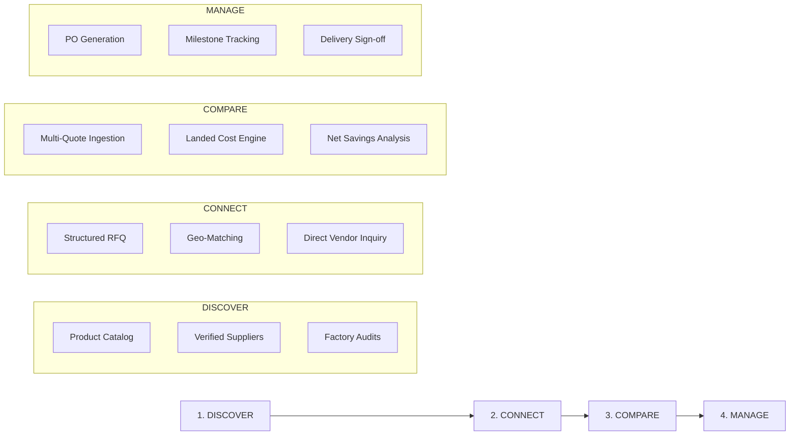

# COVERLY - Product Blueprint & System Specification

## 1. Executive Summary & Vision

**Coverly** is a B2B Wholesale Discovery, Sourcing, and Procurement Platform purpose-built for India's 63+ million Micro, Small, and Medium Enterprises (MSMEs). 

The platform's overarching mission is to transform opaque, high-friction, WhatsApp-driven wholesale commerce into an open, auditable, and mathematically transparent digital ecosystem. By solving the three central impediments of Indian B2B trade—**the trust deficit**, **the sticker-price illusion**, and **unorganized communication**—Coverly empowers MSME buyers to discover authentic suppliers, issue structured Requests for Quotation (RFQs), compare true landed costs, and execute secure commercial orders.

---

## 2. Problem Statement & Industry Context

### 2.1 The Trust Deficit
In Tier-2 and Tier-3 manufacturing clusters (e.g., Raipur, Bhilai, Ludhiana, Surat, Tiruppur), buyers frequently encounter:
- Phantom suppliers claiming non-existent factory capacity.
- Middlemen posing as original equipment manufacturers (OEMs).
- Fraudulent GSTIN identities and unverified physical premises.

### 2.2 The Sticker-Price Illusion
Informal price discovery on messaging platforms features quoted unit prices that appear cheap on paper but escalate significantly upon final billing due to:
- Opaque freight rates and variable tempo/trailer charges.
- Minimum Order Quantity (MOQ) penalties.
- Unexpected GST tax slab additions (5%, 12%, 18%, 28%).
- Loading, unloading, and transit insurance surcharges.

*Example Reality:* A Surat supplier quoting ₹196/unit can cost ₹225.40 landed in Raipur due to ₹9,800 long-haul freight, whereas a Ludhiana supplier quoting ₹205/unit lands at ₹220.05 because of regional logistics optimization.

### 2.3 Fragmented Procurement Workflows
Buyers spend an average of 6 to 8 hours per week juggling 8 to 12 scattered quotes across unstructured voice notes, handwritten paper receipts ("parchis"), and WhatsApp chats, resulting in stockouts, delayed dispatches, and zero institutional memory.

---

## 3. The Core Product Workflow

Coverly organizes the complete B2B buying journey into four distinct, progressive phases:

$$\text{DISCOVER} \longrightarrow \text{CONNECT} \longrightarrow \text{COMPARE} \longrightarrow \text{MANAGE}$$



### Phase 1: DISCOVER
- **Public & Authenticated Search**: Multi-faceted filtering by product category, HSN code, target city, verified status, and minimum MOQ.
- **Supplier Showcases**: Business profiles disclosing verified physical plant locations, factory equipment, monthly output capacity, registered GSTIN, and business credentials.
- **Directory Segmentation**: Separate discovery lanes for **Manufacturers** (OEMs), **Wholesalers** (bulk inventory holders), and **Distributors** (authorized brand channel partners).

### Phase 2: CONNECT
- **Structured RFQ Creation**: Buyers specify precise technical parameters (GSM, grade, material dimensions), target quantity, delivery deadline, and destination pincode.
- **Selective & Algorithmic Matching**: Buyers can handpick specific suppliers from the directory or trigger the **Coverly Match Engine** which prioritizes audited suppliers in nearby logistics lanes.
- **Contextual Inquiries**: Direct threaded messaging tethered specifically to an RFQ reference number, preventing fragmented chat threads.

### Phase 3: COMPARE
- **Normalized Quote Cards**: Ingested quotes are dissected into itemized cost centers: Base unit price, Applicable GST rate, Lane freight, Packaging fees, and Transit insurance.
- **Landed Cost Calculator**: Real-time deterministic calculation displaying:
  $$\text{Landed Cost per Unit} = \frac{(\text{Unit Price} \times \text{Quantity} \times (1 + \text{GST})) + \text{Freight} + \text{Other Charges}}{\text{Quantity}}$$
- **Illusion Callout Banner**: Automated highlighting of the mathematically optimal quote vs. deceptive sticker prices.

### Phase 4: MANAGE
- **Purchase Order (PO) Formalization**: Binding acceptance locking the quote parameters and generating an audit-ready digital Purchase Order.
- **Lifecycle Milestones**: Progressive state tracking across 7 stages: Confirmed $\to$ Processing $\to$ Quality Inspection $\to$ Ready for Dispatch $\to$ In-Transit $\to$ Delivered $\to$ Completed.
- **Historical Procurement Vault**: Centralized archive of past supplier performance, repeat order shortcuts, and tax invoices.

---

## 4. Ground-Truth Verification Architecture

To eliminate fake trust badges and hollow self-declarations, Coverly implements a **4-Tier Independent Verification Protocol**:

```
+-------------------------------------------------------------------+
|                   COVERLY TRUST PROTOCOL                          |
+-------------------------------------------------------------------+
|  Level 1: Phone Verified                                          |
|  - OTP authentication on primary business WhatsApp/Mobile.        |
+-------------------------------------------------------------------+
|  Level 2: Email Verified                                          |
|  - Corporate or domain-verified business email validation.        |
+-------------------------------------------------------------------+
|  Level 3: Business Documents Reviewed                             |
|  - Verification Admin inspection of GSTIN Certificate, Udyam      |
|    Registration, PAN, and Trade License.                          |
+-------------------------------------------------------------------+
|  Level 4: Registration & Premise Audited                          |
|  - Cross-reference with active GST portal filing logs, premise     |
|    geo-tagging, factory machinery photos, and locked lane freight.|
+-------------------------------------------------------------------+
```

> **Strict Rule**: Each badge is discrete. A Level 1 verification never implies that Level 3 or Level 4 checks have occurred.

---

## 5. Modular Future Expansions

To maintain core platform velocity, auxiliary MSME services are architected as modular plug-ins decoupled from the core procurement workflow:

1. **Udyam & Business Setup Concierge**: Automated registration guidance for informal manufacturers transitioning to formal corporate entities.
2. **Government Scheme Explorer**: Discovery portal for credit-linked capital subsidy schemes (CLCSS), ZED certification subsidies, and CGTMSE collateral-free loans.
3. **Institutional Trade Finance**: Third-party invoice discounting and working capital credit linkages embedded at the PO acceptance milestone.

---

## 6. Success Metrics & Quantitative KPIs

Coverly tracks live platform performance without hardcoded mock counters:

| Metric | Target Baseline | Definition |
| :--- | :--- | :--- |
| **RFQ Response Rate** | $> 85\%$ | Percentage of submitted RFQs receiving $\ge 1$ supplier quote within 48h. |
| **Multi-Quote Depth** | $\ge 3.2$ quotes | Average number of competitive quotes evaluated per active RFQ. |
| **Landed Cost Variance** | $8\% - 18\%$ | Average percentage saved by buyers choosing lowest landed vs. lowest sticker. |
| **Median Time to First Quote**| $< 14\text{ hours}$ | Turnaround speed from RFQ dispatch to first supplier submission. |
| **PO Conversion Rate** | $> 28\%$ | Percentage of compared RFQs progressing into confirmed Purchase Orders. |
| **Supplier Audit Ratio** | $100\%$ | Proportion of featured suppliers possessing Level 3 or Level 4 verified credentials. |
