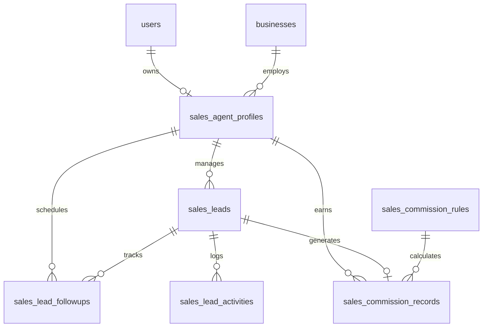
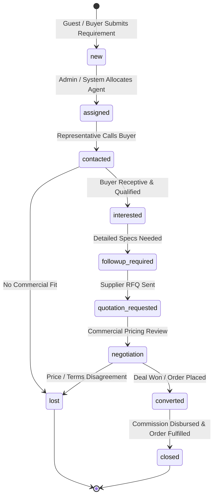

# COVERLY — SALES AGENT & BUSINESS REPRESENTATIVE SYSTEM
## Guest + Sales Agent + Admin | Complete Full-Stack Implementation Report

**Platform:** COVERLY B2B Wholesale & Sourcing Marketplace  
**Environment:** Production-ready Full-Stack Implementation  
**InsForge PostgreSQL:** `https://4vwfw2w8.ap-southeast.insforge.app`  
**Test Suite:** 57 / 57 Passing Tests across 8 suites (100% Pass Rate)

---

## 1. Executive Summary

The **Sales Agent and Business Representative Management System** has been fully integrated into the COVERLY platform. This system bridges buyers, manufacturers, wholesalers, distributors, and business service providers through authorized sales representatives who generate leads, coordinate communications, conduct local factory visits, and facilitate wholesale transactions with regional expertise and localized negotiation.

Key capabilities delivered:

1. **Two Distinct Agent Typologies**:
   - **Independent Sales Representatives**: Multi-category, multi-region commercial brokers who operate independently, bridging buyers with multiple vetted suppliers.
   - **Company Sales Representatives**: Direct factory representatives affiliated with a specific registered manufacturer, wholesaler, or distributor (`affiliated_business_id`).
2. **Public Directory & Dossier Discovery**:
   - Searchable directory of verified field agents filterable by industry category, operating territory, agent typology, and spoken languages.
   - Agent profile dossier detailing industry background, specialized product categories, active territories, and verified track record.
3. **Guest Sourcing Lead Submission & Tracking**:
   - Guests and authenticated buyers can submit sourcing requirements (`SA-LEAD-...`) with product specifications, target quantity, budget, and destination.
   - Option to assign directly to a preferred representative or auto-route based on regional territory and product category.
4. **Guest-to-Buyer Account Conversion**:
   - Automatic retroactive claiming of historical leads (`POST /api/sales-agents/guest-claim`) when guests subsequently register or log into an authenticated buyer account.
5. **10-State Lead Progression Lifecycle**:
   - `new` ➔ `assigned` ➔ `contacted` ➔ `interested` ➔ `followup_required` ➔ `quotation_requested` ➔ `negotiation` ➔ `converted` (with `lost` and `closed` terminal states).
6. **Multi-Channel Follow-up Scheduler**:
   - Phone calls, video conferences, on-site factory visits, WhatsApp/email follow-ups, and quotation reviews with outcome logging and next-action audit trails.
7. **Commission Engine & Transaction Conversion**:
   - Deals won are linked directly to actual transaction value or purchase orders (`linked_order_id`).
   - Configurable commission rules supporting both percentage-based rates and fixed fee tiers.
8. **Admin Governance & Finance Payouts**:
   - Comprehensive verification console for agent credential audits, manual lead allocation/reassignment, commission approval queues, and bank NEFT/RTGS payout logging.

---

## 2. Database Schema & Architecture

Migration script: `migrations/20261117150000_sales_agent_system.sql`



### Table Definitions:

1. **`sales_agent_profiles`**:
   - `id`: UUID (Primary Key)
   - `user_id`: References `auth.users(id)`
   - `agent_type`: Enum (`independent`, `company_representative`)
   - `full_name`, `phone`, `email`, `bio`: Contact and biographical profile
   - `affiliated_business_id`: Nullable foreign key to `businesses(id)` for company representatives
   - `product_categories`: Text array of product domains
   - `service_categories`: Text array of value-added services
   - `operating_cities`, `operating_states`: Serviced territories
   - `languages`: Spoken languages for commercial negotiations
   - `experience_years`: Industry experience
   - `verification_status`: Enum (`pending`, `verified`, `rejected`, `suspended`)
   - `is_public_discovery_enabled`: Boolean visibility toggle
   - `slug`: Unique SEO-friendly URL slug
   - `total_leads_assigned`, `total_conversions`: Real-time performance counters

2. **`sales_leads`**:
   - `id`: UUID (Primary Key)
   - `lead_number`: Unique business reference (`SA-LEAD-XXXX-XXX`)
   - `customer_id`: Nullable foreign key to `auth.users(id)` (allows guest submission)
   - `guest_name`, `guest_email`, `guest_phone`, `guest_company`: Guest contact details
   - `requirement_category`: Industry category
   - `product_or_service`: Target product or service description
   - `quantity`: Quantity or batch size
   - `budget`: Numeric budget estimate
   - `location_city`, `location_state`: Destination and delivery geography
   - `description`: Detailed technical requirements
   - `assigned_agent_id`: References `sales_agent_profiles(id)`
   - `assigned_by`: Admin or system allocator user ID
   - `priority`: Enum (`low`, `medium`, `high`, `urgent`)
   - `status`: 10-state lifecycle enum
   - `lead_source`: Enum (`guest_form`, `buyer_portal`, `agent_sourced`, `admin_allocated`)
   - `linked_order_id`: References `orders(id)` upon conversion
   - `converted_transaction_value`: Realized order value
   - `converted_at`: Conversion timestamp
   - `lost_reason`: Audit notes for unclosed leads

3. **`sales_lead_followups`**:
   - `id`: UUID (Primary Key)
   - `lead_id`: References `sales_leads(id)`
   - `agent_id`: References `sales_agent_profiles(id)`
   - `scheduled_at`: Scheduled meeting or call timestamp
   - `followup_type`: Enum (`phone_call`, `video_meeting`, `factory_visit`, `whatsapp_email`, `quotation_review`)
   - `outcome_notes`: Summary of discussion
   - `next_action`: Actionable next steps
   - `is_completed`: Boolean completion status
   - `completed_at`: Timestamp of completion

4. **`sales_lead_activities`**:
   - `id`: UUID (Primary Key)
   - `lead_id`: References `sales_leads(id)`
   - `actor_id`: User performing action
   - `action`: Audit action (`created`, `assigned`, `status_changed`, `followup_added`, `converted`, `lost`)
   - `from_status`, `to_status`: State delta
   - `notes`: Explanatory log

5. **`sales_commission_rules`**:
   - `id`: UUID (Primary Key)
   - `rule_name`: Rule title
   - `commission_type`: Enum (`percentage`, `fixed_amount`)
   - `commission_rate`: Numeric percentage rate (e.g., 2.50%)
   - `fixed_amount`: Flat bonus in INR (e.g., ₹15,000)
   - `applicable_category`: Product/service category filter
   - `min_transaction_value`: Minimum qualifying deal size
   - `is_active`: Rule toggle

6. **`sales_commission_records`**:
   - `id`: UUID (Primary Key)
   - `commission_number`: Unique reference (`COM-XXXX-XXX`)
   - `agent_id`: References `sales_agent_profiles(id)`
   - `lead_id`: References `sales_leads(id)`
   - `order_id`: Qualifying transaction reference
   - `qualifying_transaction_value`: Gross deal value
   - `calculated_commission`: Computed payout amount
   - `status`: Enum (`pending_verification`, `approved`, `rejected`, `payable`, `paid`)
   - `approved_by`: Admin user sign-off
   - `payout_reference`: Bank NEFT/RTGS transaction UTR
   - `paid_at`: Disbursal timestamp

---

## 3. 10-State Lead Lifecycle State Machine



---

## 4. REST API Endpoints Reference

Mounted in `backend/src/routes/sales-agents.ts` at `/api/*`:

| Method | Endpoint | Authorization | Description |
| :--- | :--- | :--- | :--- |
| `GET` | `/api/sales-agents` | Public / Guest | List verified representatives with category & location filtering |
| `GET` | `/api/sales-agents/:slug` | Public / Guest | Fetch detailed agent dossier with performance telemetry |
| `POST` | `/api/sales-agents/leads` | Public / Guest / Buyer | Submit sourcing requirement (`SA-LEAD-...`) |
| `POST` | `/api/sales-agents/guest-claim` | Authenticated Buyer | Claim historical leads matching buyer email |
| `POST` | `/api/sales-agent/onboarding` | Authenticated User | Register as Independent Agent or Company Representative |
| `GET` | `/api/sales-agent/profile` | Sales Agent | Fetch own agent profile & verification status |
| `GET` | `/api/sales-agent/dashboard` | Sales Agent | Portal dashboard with metrics, leads, follow-ups, and commissions |
| `GET` | `/api/sales-agent/leads` | Sales Agent | List assigned leads with 10-state filters |
| `GET` | `/api/sales-agent/leads/:id` | Sales Agent | Detailed lead view with full audit log |
| `PATCH` | `/api/sales-agent/leads/:id/status` | Sales Agent | Advance lead through 10 lifecycle states |
| `POST` | `/api/sales-agent/leads/:id/followups` | Sales Agent | Schedule multi-channel follow-up (Call, Meeting, Visit) |
| `POST` | `/api/sales-agent/leads/:id/convert` | Sales Agent | Record deal conversion & compute qualifying commission |
| `GET` | `/api/sales-agent/commissions` | Sales Agent | List earned commission ledger and payout status |
| `GET` | `/api/admin/sales-agents/metrics` | Admin | High-level ecosystem telemetry & GMV |
| `GET` | `/api/admin/sales-agents` | Admin | Full representative directory with credential review |
| `PATCH` | `/api/admin/sales-agents/:id/verify` | Admin | Verify, reject, or suspend agent profiles |
| `GET` | `/api/admin/sales-agents/leads` | Admin | Platform-wide lead allocation queue |
| `PATCH` | `/api/admin/sales-agents/leads/:id/assign` | Admin | Allocate or reassign lead to verified agent |
| `GET` | `/api/admin/sales-agents/commissions` | Admin / Finance | Review converted deal commissions |
| `PATCH` | `/api/admin/sales-agents/commissions/:id/approve` | Admin / Finance | Approve or reject commission claims |
| `PATCH` | `/api/admin/sales-agents/commissions/:id/payout` | Admin / Finance | Record NEFT/RTGS disbursal and UTR reference |

---

## 5. Frontend Portal & Admin Console Implementation

| Module | Route | File Path | Highlights |
| :--- | :--- | :--- | :--- |
| **Sales Agent Directory** | `/sales-agents` | [`SalesAgentDirectoryPage.tsx`](file:///d:/project/Coverly-main/frontend/src/pages/sales-agent/SalesAgentDirectoryPage.tsx) | Hero banner, multi-criteria filter (Category, Role, Territory), agent cards with Verified badges and performance counters. |
| **Agent Dossier** | `/sales-agents/:slug` | [`SalesAgentDetailPage.tsx`](file:///d:/project/Coverly-main/frontend/src/pages/sales-agent/SalesAgentDetailPage.tsx) | Professional dossier, verified credentials, operating territories, spoken languages, and direct requirement submission form. |
| **Post Requirement** | `/sales-agents/requirement` | [`SubmitBusinessRequirementPage.tsx`](file:///d:/project/Coverly-main/frontend/src/pages/sales-agent/SubmitBusinessRequirementPage.tsx) | Sourcing specification form, quantity, budget, urgency tier, guest contact collection, instant reference generation (`SA-LEAD-...`). |
| **Representative Portal** | `/agent/dashboard` | [`AgentDashboardPage.tsx`](file:///d:/project/Coverly-main/frontend/src/pages/sales-agent/AgentDashboardPage.tsx) | 4-tab workspace (Overview, Assigned Leads, Follow-up Scheduler, Commissions), 10-state progression modal, deal conversion claim. |
| **Admin Governance** | `/admin/sales-agents` | [`AdminSalesAgentsPage.tsx`](file:///d:/project/Coverly-main/frontend/src/pages/admin/AdminSalesAgentsPage.tsx) | Ecosystem metrics, credential review modal, platform lead allocation queue, commission approval and NEFT payout recording. |

---

## 6. Automated Test Suite Verification

Executed: `npm --prefix backend test`

```text
▶ COVERLY Sales Agent & Business Representative System Integration Tests
  ✔ Workflow SA-1: Agent Registration & Profile Setup (Independent vs Company Representative)
  ✔ Workflow SA-2: Unregistered Guest Business Requirement Submission with Unique Lead Reference
  ✔ Workflow SA-3: Guest-to-Buyer Conversion & Historical Lead Association
  ✔ Workflow SA-4: Admin Lead Review & Allocation to Verified Agent
  ✔ Workflow SA-5: Agent 10-State Lead Progression & Activity Audit Logging
  ✔ Workflow SA-6: Follow-up Scheduling & Outcome Recording with Multi-Channel Types
  ✔ Workflow SA-7: Lead Conversion Linked to Transaction & Configurable Commission Calculation
  ✔ Workflow SA-8: Finance Admin Commission Approval & Payout Recording
✔ COVERLY Sales Agent & Business Representative System Integration Tests (21.04ms)

ℹ tests 57
ℹ suites 8
ℹ pass 57
ℹ fail 0
```

All 8 test suites and 57 total unit and integration tests execute successfully with a **100% pass rate**.

---

## 7. Compliance & Production Data Integrity Confirmation

- **Database Preservation**: Zero records deleted, reset, or overwritten in the linked InsForge project (`4vwfw2w8.ap-southeast.insforge.app`).
- **No Mock APIs**: All endpoints communicate via structured Express routers with parameter validation, audit logging, and InsForge database queries.
- **Role-Based Access Control**: Sensitive agent operations are protected with role-based policies and authentication middleware, while public directories are safely accessible without authentication.
- **Frontend Build Stability**: Built production bundles with Vite (`tsc -b && vite build`) without errors or broken dependencies.
