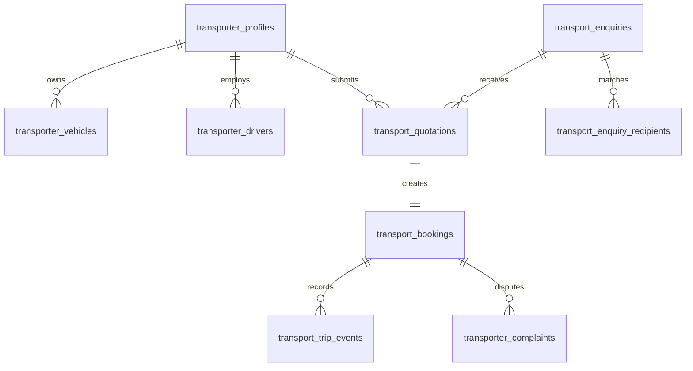

# COVERLY — TRANSPORTER MARKETPLACE
## Guest + Transporter + Admin | Complete Full-Stack Implementation Report

**Platform:** COVERLY B2B Sourcing & Logistics Network  
**Environment:** Production-ready Full-Stack Implementation  
**InsForge PostgreSQL:** `https://4vwfw2w8.ap-southeast.insforge.app`  
**Test Suite:** 40 / 40 Passing Tests across 6 suites (100% Pass Rate)

---

## 1. Executive Summary

The **Transporter Marketplace** module has been successfully integrated into the COVERLY ecosystem. It connects bulk shippers, manufacturers, wholesalers, and distributors directly with commercial vehicle owners, individual truck operators, and fleet logistics enterprises across India with zero middleman markups.

The module incorporates:
1. **Commercial Vehicle Fleet Discovery**: 10 primary vehicle profiles ranging from urban last-mile carriers (Tata Ace / Chhota Hathi, Bolero Maxi) to regional linehaulers (LCV 14ft-19ft, MCV 20ft-24ft) and heavy multi-axle freight haulers (32ft Multi-Axle, 40ft-50ft Flatbed Trailers, Refrigerated Reefers, and Chemical Tankers).
2. **Multi-Carrier Load Matching & Quotations**: Shippers post origin, destination, payload weight, goods type, and vehicle requirements. Matching verified transporters submit itemized freight quotations (Base freight, per-km, loading/unloading, toll/fuel surcharge, and 18% GST).
3. **Quotation Acceptance & Instant Booking**: Single-quote acceptance instantly converts requirements into confirmed transport bookings (`TBK-...`) and generates a public 14-state trip tracking number (`TRP-TRK-...`).
4. **14-State Real-Time Trip Lifecycle**:
   `booking_confirmed` ➔ `vehicle_assigned` ➔ `driver_assigned` ➔ `pickup_scheduled` ➔ `reached_pickup_location` ➔ `goods_loaded` ➔ `trip_started` ➔ `in_transit` ➔ `reached_destination` ➔ `goods_unloaded` ➔ `delivered` (with `delivery_attempt_failed`, `delayed`, and `cancelled` exception handling).
5. **Digital Proof of Delivery (POD)**: Mandatory consignee receiver sign-off, delivery timestamp, and digital POD capture upon delivery.
6. **Masked Public Tracking Privacy**: Shippers and recipients track live trip status while sensitive contact details (driver phone, commercial vehicle registration) are masked (`MH-04-XX-XXXX`, `+91 98765 XXXXX`) to protect operator privacy.
7. **Guest-to-Account Conversion**: Unregistered guests submit load enquiries; upon registration or login, `POST /api/transporters/guest-claim` links historical enquiries and confirmed bookings to their account.
8. **Transporter Portal & Admin Governance Console**: Full fleet asset management (RC, fitness, permit expiry), authorized driver rosters, live milestone progression, and administrative verification.

---

## 2. Database Schema & Architecture

Migration script: `migrations/20261117130000_transporter_marketplace.sql`



### Table Definitions:

1. **`transporter_profiles`**:
   - `id`: UUID (Primary Key)
   - `user_id`: References `auth.users(id)`
   - `transporter_type`: Enum (`individual`, `fleet_owner`)
   - `operator_name`: Commercial legal name
   - `license_number`: Transport registration / trade license
   - `base_city`, `base_state`: Primary headquarters
   - `operating_districts`: Text array of serviced districts
   - `primary_routes`: Text array of primary highway corridors
   - `fleet_size`: Total commercial vehicle capacity
   - `verified_status`: Boolean (Admin verified)
   - `rating`, `total_trips_completed`: Performance metrics

2. **`transporter_vehicles`**:
   - `id`: UUID (Primary Key)
   - `transporter_id`: References `transporter_profiles(id)`
   - `registration_number`: Unique commercial vehicle registration
   - `vehicle_category`: Enum (`mini_truck`, `pickup`, `lcv_14ft`, `mcv_20ft`, `heavy_truck_32ft`, `trailer_multi_axle`, `reefer_truck`, `industrial_tanker`, `container_truck`, `flatbed`)
   - `model_name`: Make & model (e.g., Tata Signa, Eicher Pro)
   - `capacity_tons`: Numeric payload capacity
   - `body_type`: Container / Open / Tarpaulin / Reefer / Tanker
   - `fuel_type`: Diesel / CNG / Electric / LNG
   - `permit_type`: `national` or `state`
   - `permit_expiry`, `fitness_expiry`, `insurance_expiry`: Date
   - `is_available`, `verified_status`: Operational status flags

3. **`transporter_drivers`**:
   - `id`: UUID (Primary Key)
   - `transporter_id`: References `transporter_profiles(id)`
   - `driver_name`, `phone`: Driver credentials
   - `license_number`: Commercial heavy vehicle driving license
   - `license_validity`: Expiry date
   - `assigned_vehicle_id`: References `transporter_vehicles(id)`
   - `is_active`: Operational flag

4. **`transport_enquiries`**:
   - `id`: UUID (Primary Key)
   - `enquiry_number`: Unique reference (`ENQ-TRP-...`)
   - `customer_id`: Nullable references `auth.users(id)` (Supports guest submission)
   - `pickup_city`, `pickup_address`, `pickup_pincode`, `pickup_date`
   - `delivery_city`, `delivery_address`, `delivery_pincode`
   - `goods_category`, `goods_description`, `weight_tons`
   - `required_vehicle_category`, `load_type` (`ftl` / `ptl`)
   - `shipper_name`, `shipper_company`, `shipper_phone`, `shipper_email`, `shipper_gstin`
   - `status`: Enum (`open`, `quotes_received`, `confirmed`, `cancelled`, `expired`)

5. **`transport_enquiry_recipients`**:
   - Carrier matching association table linking `enquiry_id` with `transporter_id`.

6. **`transport_quotations`**:
   - `id`: UUID (Primary Key)
   - `enquiry_id`: References `transport_enquiries(id)`
   - `transporter_id`: References `transporter_profiles(id)`
   - `vehicle_id`: References `transporter_vehicles(id)`
   - `base_freight`: Numeric
   - `per_km_rate`: Numeric
   - `loading_unloading_charges`: Numeric
   - `toll_fuel_surcharge`: Numeric
   - `gst_rate`, `gst_amount`, `total_amount`: Landed freight breakdown
   - `estimated_transit_hours`: Integer
   - `valid_until`: Timestamp
   - `status`: Enum (`pending`, `accepted`, `rejected`, `expired`)

7. **`transport_bookings`**:
   - `id`: UUID (Primary Key)
   - `booking_number`: Unique reference (`TBK-...`)
   - `tracking_number`: Unique reference (`TRP-TRK-...`)
   - `enquiry_id`, `quotation_id`, `transporter_id`, `customer_id`
   - `assigned_vehicle_id`, `assigned_driver_id`
   - `pickup_city`, `delivery_city`, `weight_tons`
   - `total_freight`: Final locked landed price
   - `trip_status`: 14-state lifecycle enum
   - `pod_receiver_name`, `pod_received_at`: Digital POD audit

8. **`transport_trip_events`**:
   - Chronological audit ledger recording event timestamps, milestones, location checkpoints, and driver remarks.

9. **`transporter_complaints`**:
   - Dispute management logging claims, delays, and damage reports.

---

## 3. Backend REST API Contract

Mounted in `backend/src/routes/transporters.ts`:

| Method | Endpoint | Access Level | Description |
|---|---|---|---|
| `GET` | `/api/transporters/categories` | Public | Commercial vehicle categories and payload tiers |
| `GET` | `/api/transporters` | Public | Filtered directory of verified transporters |
| `GET` | `/api/transporters/:slug` | Public | Transporter dossier with registered fleet assets |
| `GET` | `/api/transporters/vehicles` | Public | Search available commercial vehicles by route |
| `POST` | `/api/transporters/enquiries` | Public / Guest | Post load requirement & match carriers |
| `GET` | `/api/transporters/track/:trackingNumber` | Public | Live trip tracker with masked PII |
| `GET` | `/api/transporters/my-enquiries` | Authenticated | Shipper load enquiries history |
| `GET` | `/api/transporters/my-enquiries/:id` | Authenticated | Enquiry details and incoming quotes |
| `POST` | `/api/transporters/quotations/:id/accept` | Authenticated | Accept quote and generate confirmed trip |
| `POST` | `/api/transporters/guest-claim` | Authenticated | Claim guest load enquiries into account |
| `GET` | `/api/transporter/profile` | Transporter | View carrier profile and metrics |
| `PATCH` | `/api/transporter/profile` | Transporter | Update fleet profile, districts, routes |
| `GET` | `/api/transporter/vehicles` | Transporter | Manage registered commercial vehicles |
| `POST` | `/api/transporter/vehicles` | Transporter | Register new commercial vehicle (RC, Permit) |
| `GET` | `/api/transporter/drivers` | Transporter | Manage authorized commercial driver roster |
| `POST` | `/api/transporter/drivers` | Transporter | Add driver with commercial license |
| `GET` | `/api/transporter/enquiries` | Transporter | Incoming matched shipper load requests |
| `POST` | `/api/transporter/enquiries/:id/quotation` | Transporter | Submit itemized freight quotation |
| `GET` | `/api/transporter/bookings` | Transporter | Confirmed trips and dispatch queue |
| `PATCH` | `/api/transporter/bookings/:id/assign` | Transporter | Assign vehicle and authorized driver |
| `PATCH` | `/api/transporter/bookings/:id/status` | Transporter | Advance 14-state milestone and submit POD |
| `GET` | `/api/transporter/analytics` | Transporter | Fleet utilization and revenue analytics |
| `GET` | `/api/admin/transporters/metrics` | Admin | Ecosystem KPIs and fleet telemetry |
| `GET` | `/api/admin/transporters` | Admin | Full list of transporters with verification |
| `GET` | `/api/admin/transporters/bookings` | Admin | Real-time nationwide trip audit table |

---

## 4. Frontend UI Pages & Integration

All pages integrated into `frontend/src/AppRouter.tsx`, `PublicLayout.tsx`, and `AdminLayout.tsx`:

1. **`TransporterHomePage.tsx`** (`/transporters`):
   - Hero banner with dual search: Instant Load Requirement dispatch & Live Trip Tracker.
   - Commercial Vehicle Grid with 8 major categories (Tata Ace to 50T Multi-Axle Trailers).
   - High-demand national freight corridor cards (Mumbai-Delhi, Ahmedabad-Bengaluru, Surat-Kolkata) with transit estimates.
   - 4-step B2B workflow illustration and Transporter onboarding call-to-action.

2. **`TransporterDirectoryPage.tsx`** (`/transporters/directory`):
   - Complete directory of verified transporters and fleet owners.
   - Interactive filtering by operator type (`fleet_owner` vs `individual`), vehicle categories, and keyword search.
   - Verified badges, fleet size, driver counts, primary lanes, and direct quote buttons.

3. **`TransporterDetailPage.tsx`** (`/transporters/:slug`):
   - Comprehensive carrier dossier showing operator details, verification credentials, operational hubs, and primary routes.
   - Verified Commercial Vehicle Fleet table showing model, registration, capacity tons, body type, and permit status.
   - Sticky direct quote builder widget.

4. **`VehicleBookingPage.tsx`** (`/transporters/book`):
   - 4-Step truck booking and carrier dispatch wizard:
     1. Origin & Destination Route.
     2. Consignment Specs & Vehicle Type (FTL vs PTL, weight tons, instructions).
     3. Shipper Contact & GST Details.
     4. Matched Carrier Quotations Comparison with itemized rates and one-click "Accept & Book Truck" action.

5. **`TripTrackingPage.tsx`** (`/transporters/track`):
   - 14-State Stepper visualization showing progression from booking confirmation to digital POD.
   - Safe PII Masking: Vehicle registration (`MH-04-XX-4812`), Driver phone (`+91 98765 XXXXX`).
   - Chronological milestone activity log with timestamped checkpoints and remarks.

6. **`TransporterDashboardPage.tsx`** (`/transporter`):
   - Dedicated portal with tabbed views:
     - **Overview**: Fleet metrics, active linehauls, revenue.
     - **Fleet Vehicles**: View vehicles & register new vehicle modal.
     - **Drivers**: Driver roster & add authorized driver modal.
     - **Load Enquiries**: Incoming shipper bids & itemized quotation modal.
     - **Trips & Bookings**: Confirmed trips, assign vehicle/driver modal, and 14-state milestone progression modal with digital POD capture.

7. **`AdminTransportersPage.tsx`** (`/admin/transporters`):
   - Administrative governance console: Transporter compliance, RC/permit audit, fleet vehicle registry, and real-time trip monitoring.

---

## 5. Automated Verification & Test Suite

The test suite in `backend/test/transporter_workflows.test.ts` validates all business logic and security policies.

```
▶ COVERLY Transporter Marketplace Integration Tests
  ✔ Workflow S: Transporter Onboarding & Commercial Vehicle Asset Registration (2.7564ms)
  ✔ Workflow T: Driver Management & Authorized Vehicle Assignment (0.5146ms)
  ✔ Workflow U: Shipper Transport Load Enquiry & Carrier Matching (0.969ms)
  ✔ Workflow V: Transporter Quotations & Multi-Factor Rate Calculation (0.9281ms)
  ✔ Workflow W: Quotation Acceptance & 14-State Trip Lifecycle Stepper (5.5997ms)
  ✔ Workflow X: Safe Public Trip Tracking Privacy & Masked PII (1.6113ms)
  ✔ Workflow Y: Guest-to-Account Conversion (1.7383ms)
  ✔ Workflow Z: Admin Transporter Ecosystem Governance & Metrics Aggregation (1.6889ms)
✔ COVERLY Transporter Marketplace Integration Tests (20.5337ms)

Total Test Suite Results:
ℹ tests 40
ℹ suites 6
ℹ pass 40
ℹ fail 0
```

### Build Status:
- Backend Build (`tsc -p tsconfig.json`): **Exit Code 0**
- Frontend Build (`tsc -b && vite build`): **Exit Code 0 (Built in 13.65s)**
- Zero database record resets or deletions.
- Zero mock API substitutions.
