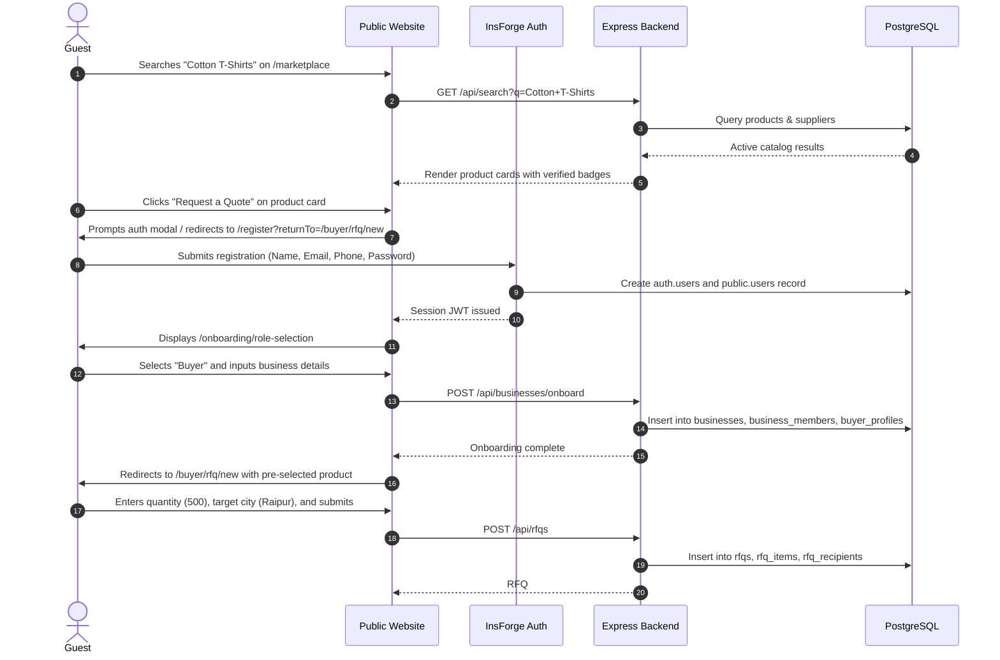
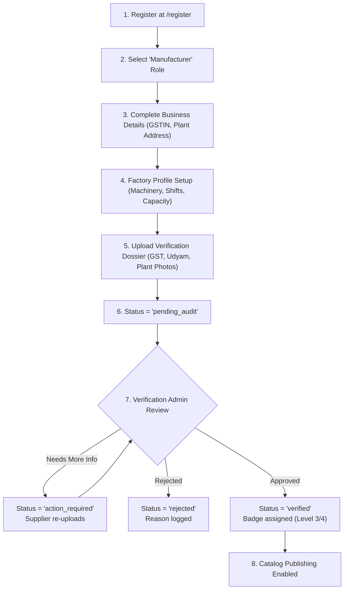
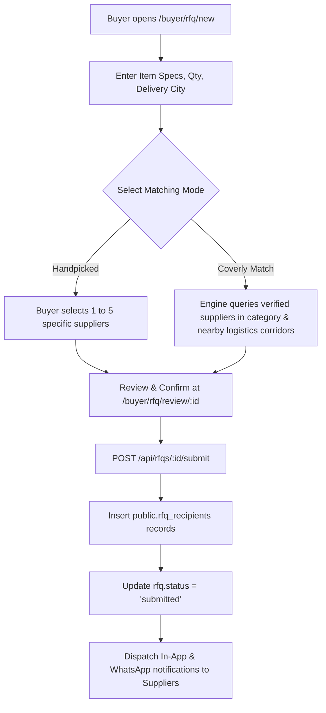
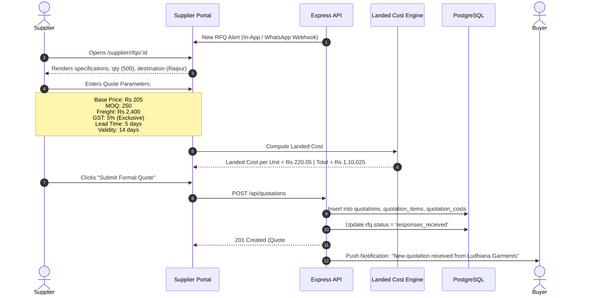
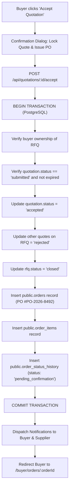
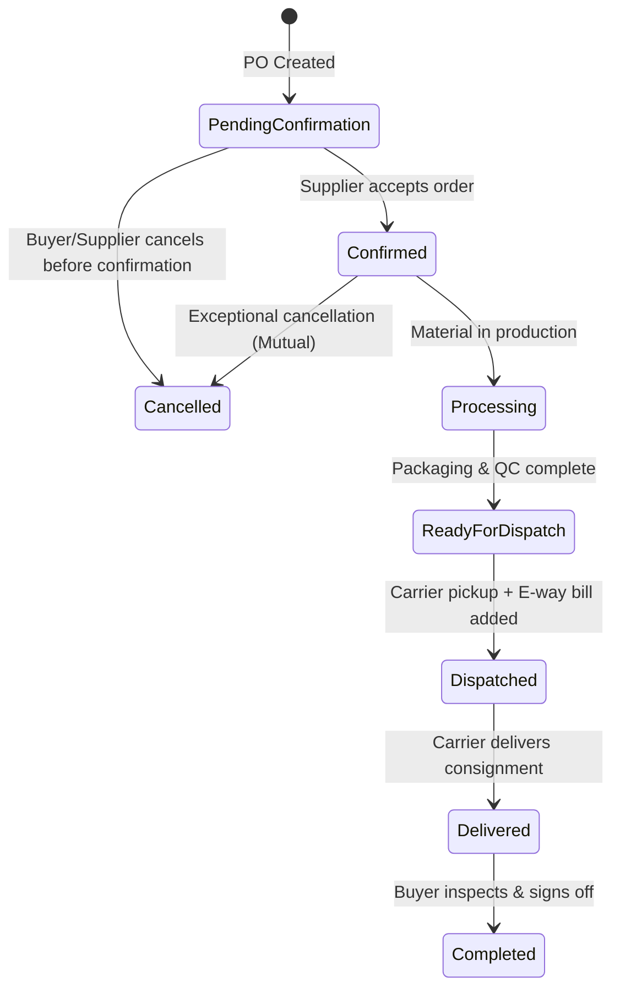
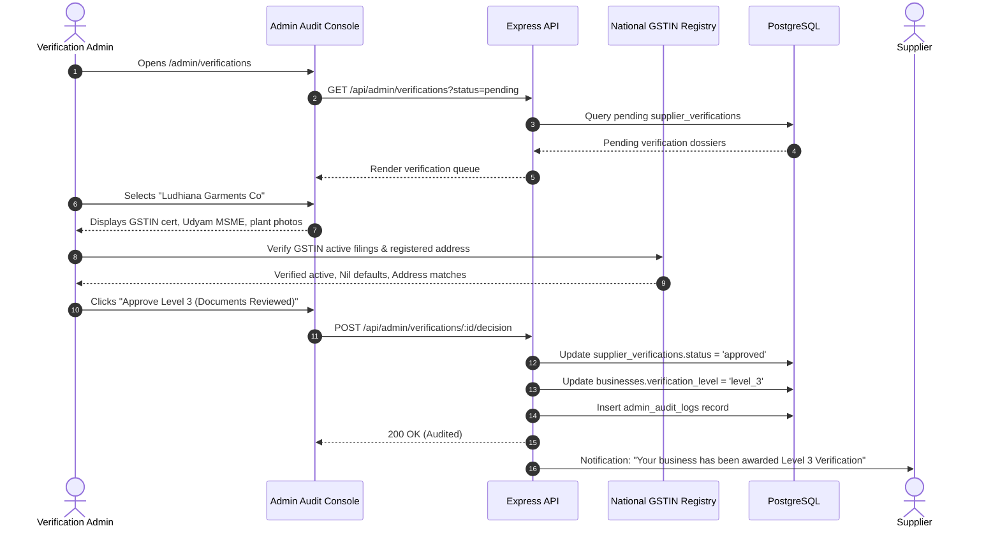
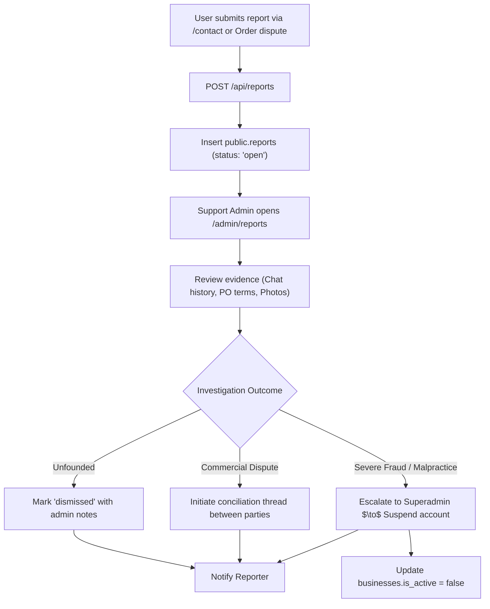

# COVERLY - End-to-End Business Workflows & State Machines

This document specifies the 9 core business workflows operating across COVERLY. Each workflow details the participating actors, preconditions, chronological steps across UI and backend, database state transitions, and edge-case handling.

---

## Workflow 1: Guest to Buyer Journey

### Overview
Transforms an anonymous visitor discovering products or suppliers on the public website into an authenticated buyer submitting an actionable Request for Quotation (RFQ).



### Preconditions
- Visitor is unauthenticated (Guest session).
- Target product exists in public catalog.

### Step-by-Step Sequence
1. **Discovery**: Guest searches `/marketplace` or `/categories/cotton-tshirts` and locates a product.
2. **Intent Trigger**: Guest clicks "Request a Quote".
3. **Session Intercept**: Router detects unauthenticated state, preserves intended destination (`/buyer/rfq/new?productId=X`) in session storage, and routes to `/register`.
4. **Account Creation**: Guest registers with Name, Work Email, Mobile Phone, and Password.
5. **Role Confirmation**: User confirms "Buyer" role at `/onboarding/role-selection`.
6. **Company Profile**: User enters Company Legal Name, GSTIN (or opts for micro-buyer exemption), and Shipping City/Pincode.
7. **Action Resumption**: Onboarding completes and router restores preserved RFQ draft.
8. **Submission**: Buyer inputs target quantity and delivery deadline, then clicks "Confirm & Dispatch RFQ".

### Postconditions
- User authenticated with role `buyer`.
- Business profile created and linked.
- RFQ record stored with status `submitted`.
- Matching suppliers receive notification alert.

---

## Workflow 2: Manufacturer Onboarding & Ground-Truth Verification

### Overview
A manufacturing factory registers, builds its industrial capability profile, submits regulatory documents, and completes a ground-truth audit by a Verification Admin.



### Preconditions
- Supplier owns legitimate manufacturing plant or warehouse.
- Valid GSTIN, PAN, and Udyam MSME certificates available.

### Step-by-Step Sequence
1. **Registration**: Manufacturer signs up at `/register`.
2. **Persona Selection**: Selects `Manufacturer` on `/onboarding/role-selection`.
3. **Corporate Identification**: Enters Registered Business Name, Trade Name, GSTIN, PAN, Factory Address, and Primary Category.
4. **Capability Profile**: At `/supplier/profile`, defines installed machinery (e.g., circular knitting machines), monthly production capacity (e.g., 50,000 units), operating shifts, and testing facilities.
5. **Dossier Upload**: At `/supplier/verification/submit`, uploads:
   - Certificate of GST Registration (PDF)
   - Udyam MSME Registration (PDF)
   - Recent Factory Electricity Bill (PDF)
   - Geo-tagged photos of factory floor and entrance signboard (JPG/PNG).
6. **Admin Audit**: Verification Admin inspects document authenticity, checks active status on GST portal, and verifies premise coordinates.
7. **Badge Assignment**: Admin approves dossier and assigns **Level 3 (Business Documents Reviewed)** or **Level 4 (Premise Audited)**.
8. **Catalog Activation**: Manufacturer adds products which immediately display the verified trust mark in public searches.

---

## Workflow 3: Buyer RFQ Creation & Matching Engine

### Overview
A buyer formulates detailed procurement requirements, delivery parameters, and dispatches an RFQ either directly to handpicked vendors or through the Coverly Geo-Matching Engine.



### Matching Algorithm Parameters
When `Coverly Match` is selected, the backend filters and ranks suppliers using:
1. **Category Relevance**: Supplier active in target category (`primary_category_id = rfq.category_id`).
2. **Logistics Proximity**: Prioritizes suppliers within same state or designated logistics lane (e.g., Raipur $\leftrightarrow$ Bhilai $\leftrightarrow$ Ludhiana $\leftrightarrow$ Surat).
3. **Verification Tier**: Level 4 and Level 3 suppliers receive priority match scoring.
4. **Historical Responsiveness**: Suppliers with $< 24\text{h}$ average quote turnaround ranked higher.

---

## Workflow 4: Supplier Quotation & Cost Breakdown Submission

### Overview
A matched supplier reviews the incoming RFQ, enters base unit pricing, lane freight, and applicable GST, previews the calculated landed cost, and dispatches a binding quotation.



### Mandatory Quotation Breakdown Elements
Every quotation record in `public.quotation_costs` stores discrete parameters:
- `unit_price`: Base price per unit (₹205.00)
- `quantity`: Quoted lot quantity (500)
- `freight`: Transport charge to destination city (₹2,400.00)
- `freight_taxable`: Whether freight is subject to GST (true/false)
- `gst_rate`: Applicable GST slab (0.05 for 5%)
- `other_charges`: Packaging, loading, or palletizing fees (₹0.00)
- `landed_cost_per_unit`: Computed deterministic landed rate (₹220.05)
- `total_landed_cost`: Full invoice estimation (₹1,10,025.00)

---

## Workflow 5: Quotation Comparison & Sticker-Price Deception Detection

### Overview
The buyer navigates to `/buyer/rfqs/:id/compare` to review multiple received quotations side-by-side. The Landed Cost Engine unmasks the "sticker-price illusion."

```
+-------------------------------------------------------------------------------+
|                    COVERLY LANDED COST COMPARISON MATRIX                      |
|                      Requirement: 500 pcs Cotton Tees to Raipur               |
+------------------------------------+--------------------+---------------------+
| Quotation Parameter                | Surat Textile Hub  | Ludhiana Garments   |
+------------------------------------+--------------------+---------------------+
| Quoted Sticker Price               | Rs 196.00 / pc     | Rs 205.00 / pc      |
| Minimum Order Quantity (MOQ)       | 500 pcs            | 250 pcs             |
| Base Subtotal (500 pcs)            | Rs 98,000.00       | Rs 1,02,500.00      |
| GST (5%)                           | Rs 4,900.00        | Rs 5,125.00         |
| Lane Freight to Raipur             | Rs 9,800.00        | Rs 2,400.00         |
+------------------------------------+--------------------+---------------------+
| TRUE LANDED COST PER UNIT          | Rs 225.40 / pc     | Rs 220.05 / pc      |
| TOTAL LOT LANDED COST              | Rs 1,12,700.00     | Rs 1,10,025.00      |
+------------------------------------+--------------------+---------------------+
| STICKER ILLUSION ANALYSIS          | Appears Rs 9/pc    | SAVES Rs 5.35/pc    |
|                                    | cheaper on sticker | Net savings: Rs2,675|
| RECOMMENDATION                     | Sticker Trap       | Best Landed Choice  |
+------------------------------------+--------------------+---------------------+
```

### Execution Steps
1. Buyer navigates to `/buyer/rfqs/:id/compare`.
2. UI requests `GET /api/rfqs/:id/comparison`.
3. Backend retrieves all quotations matching `rfq_id` with status `submitted`.
4. Landed cost formula is executed dynamically and validated against stored quote values.
5. The UI highlights the optimal landed quote with an `Illusion Callout Banner`.
6. Buyer clicks **"Accept This Quotation"** on the Ludhiana Garments column.

---

## Workflow 6: Purchase Order Creation & Transactional Locking

### Overview
When a buyer accepts a quote, an atomic backend transaction locks the quotation, creates an official Purchase Order (PO), and updates RFQ states idempotently.



### Integrity Controls
- **Idempotency**: A unique index on `orders.quotation_id` guarantees that one quotation can never produce more than one Purchase Order under any concurrency condition.
- **Race Condition Guard**: `SELECT ... FOR UPDATE` locks the quotation row during acceptance evaluation.

---

## Workflow 7: Order Fulfillment & Milestone State Transitions

### Overview
Governs the step-by-step progress of the accepted order from manufacturer processing to transport carrier dispatch, delivery confirmation, and sign-off.



### State Machine Transition Table
| From Status | To Status | Authorized Role | Mandatory Requirements |
| :--- | :--- | :--- | :--- |
| `pending_confirmation` | `confirmed` | Supplier | Supplier confirmation click |
| `confirmed` | `processing` | Supplier | Production batch ID |
| `processing` | `ready_for_dispatch` | Supplier | Packaging checklist verified |
| `ready_for_dispatch` | `dispatched` | Supplier | Carrier name, Vehicle #, E-way bill # |
| `dispatched` | `delivered` | Supplier / Carrier | Delivery pod photo or carrier API trigger |
| `delivered` | `completed` | Buyer | Buyer sign-off or auto-complete after 7 days |
| Any (pre-dispatch) | `cancelled` | Buyer / Supplier / Admin | Valid cancellation reason logged |

---

## Workflow 8: Administrator Verification & Ground-Truth Auditing

### Overview
Verification Admins inspect uploaded business dossiers, cross-reference state GST databases, and assign distinct trust badges.



---

## Workflow 9: Support, Reporting & Dispute Escalation

### Overview
Enables buyers and suppliers to report fraudulent behavior, defective consignments, or off-platform harassment, routed directly to Support Admins for resolution.



### Logging & Accountability
Every action taken by Support Admins is recorded in `public.admin_audit_logs` including Admin ID, target user/business ID, IP address, action code, and full textual reasoning.
